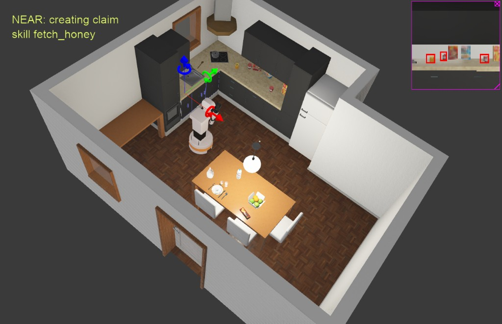
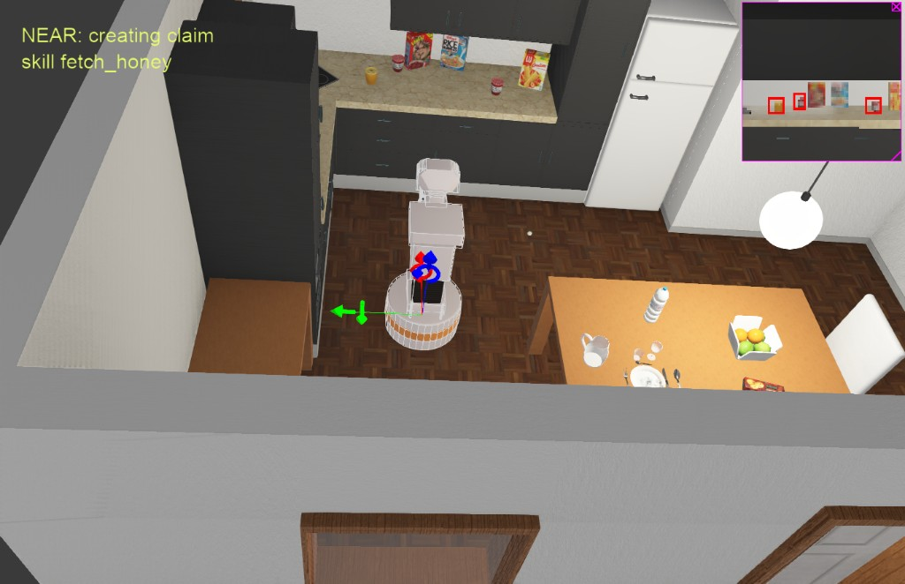
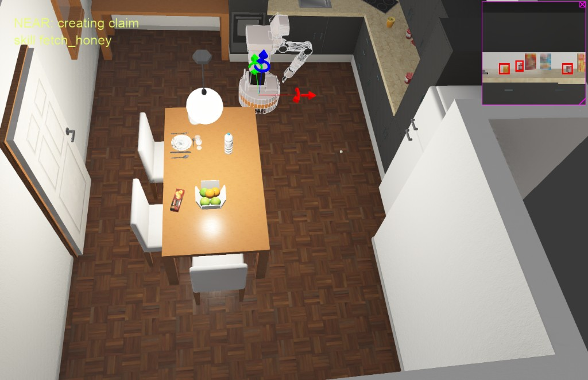

# Hotel Robot-as-a-Service on NEAR

A robot that delivers drinks and food, and gets paid for each delivery. A guest funds one job in a **NEAR task escrow**. The TIAGo robot fetches the jar in a Webots kitchen. Then the robot account calls `complete`, and `pay_supplier` sends the pantry its share. There is no monthly lease.

Hotels are the example. The same loop fits hospitals, warehouses, airports, and shops: pay the robot per skill, not per month.

To our knowledge this is the first physical-AI machine loop on NEAR. Software agents already pay each other there. Robots are the next agents, and they need the same payment layer.

Full argument: [docs/hotel-raas.md](docs/hotel-raas.md).

[](docs/media/kitchen.mp4)

TIAGo in [`worlds/kitchen.wbt`](worlds/kitchen.wbt) during `fetch_honey`. The HUD shows the NEAR claim. Open the frame for the clip.

| Aisle | Table |
| --- | --- |
|  |  |

**Tracks:** `agents` (primary), `business`, `realworld`, `swarms`, `open`.

**Open-track primitive:** one NEAR escrow for a machine whose identity lives on another chain, with the robot as both seller and buyer.

**Idea / X post:** Software agents on NEAR already move value across 35+ chains. The next wave of agents will be physical AI (robots). Hotels should pay for the delivery, not the month. The robot should pay the pantry for the jar, not file an invoice.

This repository already contained a working Webots kitchen (`worlds/kitchen.wbt`, controller `mission_control`). That world is the **baseline**. Everything under `contracts/`, `hotel/`, `config/`, and `docs/` is the hackathon settlement layer.

## The opportunity

Most robots are rented on a flat monthly lease, so a business pays for hours the robot sits idle. peaq's article on LG's CLOi robots puts the market at about $25 billion today and almost $70 billion by 2030. Paying per task fits that growth: the buyer pays for work done, and the machine earns for work done.

## Why this matters for NEAR

NEAR's own docs describe the pieces this project uses:

- Agents can use NEAR to hold assets and send transactions ([Tools for AI Agents](https://docs.near.org/getting-started/tools-for-ai)).
- Intents let a user or AI agent state the outcome it wants and have it settled ([Intents overview](https://docs.near.org/chain-abstraction/intents/overview)). Here that is the USDT exit.
- Chain Signatures let a NEAR account control accounts on Solana and other chains. This repo uses one shared Ed25519 key today, with a chain-signature spike as the next step.
- About 1.2 second finality and fees near $0.002 ([Why NEAR](https://docs.near.org/index#why-near)). That is what makes paying a robot for one delivery workable.

What this adds: a physical agent on those rails. One escrow, one key, a machine that pays another machine. Every robot that bills per task is a new reason to hold and move value on NEAR.

## The loop in one minute

1. **Identity:** the robot is registered on Solana through peaq ([machine ID below](#registered-machine-peaq-on-solana)). The same key controls its NEAR account.
2. **Fund:** the guest locks the price of `fetch_honey` in the escrow on NEAR testnet.
3. **Deliver:** in Webots the robot drives to the counter, lines up with the jar, and picks it up.
4. **Get paid:** the robot calls `complete`. Then `pay_supplier` sends 40 percent to the pantry that supplied the jar.
5. **Prove it:** the receipt lists the claim ID, both transaction hashes, and a refused courier quote that was more expensive.

The robot's controller never touches keys. It writes `settlement/outbox.json`, and a separate step makes the payments.

License: [MIT](LICENSE).

## Agent screen (no Webots, no spend)

Python **3.10+**. This path does not call NEAR, Solana, or Webots.

```bash
python -m pip install -r requirements.txt
python -m unittest tests.test_hotel -v
python -m hotel.cli quotes
python -m hotel.cli simulate-skill --skill fetch_honey
python -m hotel.cli create-claim --skill fetch_honey --offline
python -m hotel.cli watch --once --offline
```

Pass:

- Four tests print `OK`.
- `quotes` accepts `optimus2-pantry-c928.testnet` and refuses `optimus2-courier-6885.testnet`.
- The printed receipt has `complete` / `pay_supplier` `"offline"`, `webots_success` true, and a refused courier quote.

Copy `.env.example` to `.env` only if you run live commands. Never commit `.env` or `keys/`.

### Optional: Webots

Python **3.9** with `py_trees`, `numpy`, `scipy`. [controllers/mission_control/runtime.ini](controllers/mission_control/runtime.ini) `COMMAND` is a local 3.9 path. Point it at your 3.9 binary before Play, or the controller will not start.

Open [worlds/kitchen.wbt](worlds/kitchen.wbt). Default `controllerArgs` is `all` (honey, place, jam). For the two-minute demo set `HOTEL_SKILL=fetch_honey`. `HOTEL_SETTLE` defaults to `offline`. Override with the environment or a one-line gitignored `settlement/webots.env` (`live`, `offline`, or `none`). If `hotel/` is not `py -3.10`, set `HOTEL_PYTHON`.

### Optional: live NEAR, peaq, Intents

Not required to pass the screen. Accounts already live in [config/hotel.json](config/hotel.json) (`optimus2-escrow-d144.testnet` and the named guest/robot/pantry/courier). Do not invent `guest.testnet`. `python -m hotel.cli prepare-claim --skill fetch_honey` is create plus fund. `watch --once` without `--offline` needs a funded claim and `keys/`. Leave `INTENTS_LIVE=0` and `PEAQ_LIVE=0`. Dry only: `python -m hotel.cli intents-quote --dry`, `python -m hotel.cli peaq-dry`. `peaq-live` is a second bond; skip it.

## How judges score this

| Criterion | Where it is |
| --- | --- |
| Technical implementation | [contracts/task_escrow](contracts/task_escrow), [tests/test_hotel.py](tests/test_hotel.py), [hotel/dispatcher.py](hotel/dispatcher.py) |
| Design | Guest funds, robot `complete`, pantry `pay_supplier`, refused courier on the receipt |
| Impact | Pay the delivery, not the month; the pantry is paid in the same transaction pair |
| Originality | One Ed25519 key for NEAR settlement and the Solana peaq owner; the robot pays the pantry |
| Sustainability | Repeatable loop is NEAR testnet + offline CLI; function-call key is the kill switch; no second peaq activation. [Limits](#limits-read-before-judging) |

## What you will see

| You do | You see |
| --- | --- |
| `python -m hotel.cli derive-key --role robot` | One Ed25519 key, Solana address, NEAR implicit account (same 32-byte pubkey) |
| `python -m hotel.cli quotes` | Pantry path accepted; `optimus2-courier-6885.testnet` quote refused; reason on a receipt |
| Guest funds a claim (testnet) | `wrap.testnet` balance locked on `optimus2-escrow-d144.testnet`; explorer link |
| Open `worlds/kitchen.wbt` (`controllerArgs` `all`, or `HOTEL_SKILL=fetch_honey`) | TIAGo drives to the counter, grasps and lifts the honey jar; HUD shows the NEAR receipt; `settlement/outbox.json` |
| Dispatcher watches the outbox | Robot `complete` tx, robot balance up |
| Same key `pay_supplier` | Pantry balance up; robot keeps the spread (pantry_bps in config) |
| Print receipt | Claim id, both tx hashes, refused courier quote, Webots success |
| `python -m hotel.cli intents-quote --dry` | 1Click quote toward USDT. No spend |
| `python -m hotel.cli peaq-dry` | `peaqos activate --chain solana --dry-run` (no bond) |

## Registered machine (peaq on Solana)

TIAGo is onboarded on **peaq mainnet** with home chain **Solana** (Economics 2.0, **Basic** tier). The subscription bond is paid on Solana and booked on peaq. A second `peaqos activate` is refused (`MACHINE_ALREADY_ACTIVE`); **renew** instead. The bond is **not withdrawable**.

| Field | Value |
| --- | --- |
| Machine ID | `77174012743344590367033095698920089416728647386143366545675443241571867865158` |
| DID | `did:peaq:77174012743344590367033095698920089416728647386143366545675443241571867865158` |
| Solana owner (same Ed25519 key as NEAR robot) | [`2R3A29rFMorbrhZ5bGY27ERcnttaN5xzGoAPG36cxHTr`](https://solscan.io/account/2R3A29rFMorbrhZ5bGY27ERcnttaN5xzGoAPG36cxHTr) |
| peaq operator | [`0xd41587F9D5df02662Afa4AC60626154985E9149A`](https://peaq.subscan.io/account/0xd41587F9D5df02662Afa4AC60626154985E9149A) |
| Pay-in | USDC on Solana (`PEAQ_PAY_IN=USDC` in `.env`) |

On-chain onboarding (seven stages):

| Step | Chain | Transaction |
| --- | --- | --- |
| `[1/7]` Operator registration | peaq | [0xb00c6c74937b27b7b87e7ec418df0b040584b8f4c8631f9a4e471e506e002cd4](https://peaq.subscan.io/tx/0xb00c6c74937b27b7b87e7ec418df0b040584b8f4c8631f9a4e471e506e002cd4) |
| `[2/7]` Activation request | Solana | [3d54KK3ZBr4rsoiTUo4D3S7g6ymT8jWW5NpXpp65FvGo2G4BncNMEjUwegpoAA6gTkRuxywhB9mu9mEVUCLSnshs](https://solscan.io/tx/3d54KK3ZBr4rsoiTUo4D3S7g6ymT8jWW5NpXpp65FvGo2G4BncNMEjUwegpoAA6gTkRuxywhB9mu9mEVUCLSnshs) |
| `[4/7]` Settlement | Solana | [Yo7rX4WtR6AaPTTDkb9DYXo2iRFkFrC9LtNxNSKAEmuS2Vcvu5AT53BxyaMLpveQnGY67FWecwv2HBW87dAZ5sL](https://solscan.io/tx/Yo7rX4WtR6AaPTTDkb9DYXo2iRFkFrC9LtNxNSKAEmuS2Vcvu5AT53BxyaMLpveQnGY67FWecwv2HBW87dAZ5sL) |
| `[6/7]` Native onboarding (mint) | Solana | [5vLb29pG8fkaWcsAMoak9v569JhcszZrntnzyLnHEPTMKZxCZ4eWD5Yi9KSMhFzrnnMgR2ajE3uJUJjcBTYwK7K8](https://solscan.io/tx/5vLb29pG8fkaWcsAMoak9v569JhcszZrntnzyLnHEPTMKZxCZ4eWD5Yi9KSMhFzrnnMgR2ajE3uJUJjcBTYwK7K8) |
| `[7/7]` Link push Solana → peaq | Solana | [4XmP3s8hmiyQwaUYAQG4FnRrsqt98pyUv7hU25AAq3SYXwgE7nV6RkDdjPMmnBJyZACjkN5wCp9HGaMii3rAHGvw](https://solscan.io/tx/4XmP3s8hmiyQwaUYAQG4FnRrsqt98pyUv7hU25AAq3SYXwgE7nV6RkDdjPMmnBJyZACjkN5wCp9HGaMii3rAHGvw) |

Bond (approximate): **0.193924 USDC** used (~8.17 PEAQ bond), **0.001939 USDC** returned, **~0.0105 PEAQ** operator registration gas. `[3/7]` credit and `[5/7]` bond are driven by the Trust Validator node on peaq (no separate owner tx in the audit summary).

**Activity event** for NEAR testnet **claim-3** (`fetch_honey`, trust 0, NEAR hashes in `rawData`): [3kq4G8G7wFgPWk4BeMnsUTMc5V4majisddFntapR3HR2f7gjMjYRrEHjNpqRRvkrZ1mXQxF6mcyLiDdhVzuWWYod](https://solscan.io/tx/3kq4G8G7wFgPWk4BeMnsUTMc5V4majisddFntapR3HR2f7gjMjYRrEHjNpqRRvkrZ1mXQxF6mcyLiDdhVzuWWYod) on Solana EventRegistry. Submit again with `python -m hotel.cli peaq-event --receipt settlement/receipts/claim-3.json` when `PEAQ_LIVE=1`.

**NEAR testnet** settlement for the same skill (**claim-3**): [complete `CDkuc1mHHNTKAsgKEvMXkxfQ1cRyGen6oVry3AK13omn`](https://testnet.nearblocks.io/txns/CDkuc1mHHNTKAsgKEvMXkxfQ1cRyGen6oVry3AK13omn), [pay_supplier `2KsbtMBa3nwzDXNmR5GwZg9pv9LqmvSQGpsWWMtMdwxV`](https://testnet.nearblocks.io/txns/2KsbtMBa3nwzDXNmR5GwZg9pv9LqmvSQGpsWWMtMdwxV).

**Latest live kitchen claim (claim-4):** [create](https://testnet.nearblocks.io/txns/5BKPQXgq8bWjdS8JU8iQEKcEE4xgtedE5PHcfPH1rWzA), [fund](https://testnet.nearblocks.io/txns/Dijs8gk1qYcXJMv4ReDACFSXTkAaQAgWzUDkrMKNqoES), [complete](https://testnet.nearblocks.io/txns/GtifFSDD78BpZ29SAnEetLjQPuXf56pYaxRAjx4iSA9W), [pay_supplier](https://testnet.nearblocks.io/txns/43VE9E9VFR7BZ8TyxDCbgJi12oBKrHPN6y5mNe6DvbFD).

Full committed audit trail (peaq, Intents bridge, all claims): [docs/on-chain-record.md](docs/on-chain-record.md).

## Requirements

- Python **3.10+** for `hotel/` and `python -m unittest tests.test_hotel -v` (`pip install -r requirements.txt`)
- Webots R2023+ is optional. Controller Python **3.9** with `py_trees`, `numpy`, `scipy`. Edit `COMMAND` in [controllers/mission_control/runtime.ini](controllers/mission_control/runtime.ini) to your 3.9 binary
- Optional: Rust + `cargo` to rebuild [`contracts/task_escrow`](contracts/task_escrow)
- Optional: `peaq-os-cli[solana,ows]` **0.0.19+** for `peaq-dry`
- Optional live: keys under `keys/` for the named accounts already in [config/hotel.json](config/hotel.json)

Copy `.env.example` to `.env` for live runs. Never commit keys. `keys/` is gitignored.

## Run end-to-end (Webots + settlement)

Operator walkthrough (NEAR, Solana machine registration, Intents, where to follow txs): [docs/run-end-to-end.md](docs/run-end-to-end.md).

Webots uses Python **3.9** (`controllers/mission_control/runtime.ini`). `hotel/` needs Python **3.10+**. The controller never imports `hotel`; it writes `settlement/outbox.json` and overlays the receipt with `Supervisor.setLabel`.

`worlds/kitchen.wbt` ships TIAGo with `controllerArgs` `all`. Settlement mode is `HOTEL_SETTLE` (`offline` default, `live`, or `none`), from the environment or gitignored `settlement/webots.env`. If the 3.10 binary is not `py -3.10`, set `HOTEL_PYTHON` to that interpreter.

### A. Offline (no testnet; proves drive + HUD)

1. `pip install -r requirements.txt` on Python 3.10+.
2. `python -m hotel.cli derive-key --role robot` (and `pantry`, `guest`, `courier`) if `keys/` is empty.
3. `python -m hotel.cli create-claim --skill fetch_honey --offline`
4. In Webots: **File → Reload World**, then Play. Optional env: `HOTEL_SETTLE=offline`.
5. **See:** TIAGo starts at `(0, 0.25)` (the reference kitchen pose), follows the mapped path, grasps the honey jar, then a HUD: claim id, `complete` / `pay_supplier` `offline`, refused courier quote.

### B. Live NEAR testnet (do not invent accounts)

[config/hotel.json](config/hotel.json) already names the contract and roles. Copy `.env.example` to `.env` and point key files at `keys/` for those same accounts.

| Field | Where | What you put |
| --- | --- | --- |
| `NEAR_ESCROW_ACCOUNT` | `.env` (overrides config) | `optimus2-escrow-d144.testnet` unless you deployed your own wasm |
| Guest / robot / pantry / courier | `config/hotel.json` `accounts` | `optimus2-guest-d144.testnet`, `optimus2-tiago-f63d.testnet`, `optimus2-pantry-c928.testnet`, `optimus2-courier-6885.testnet` |
| `NEAR_FT_CONTRACT` | `.env` | `wrap.testnet` |
| `ROBOT_KEYFILE` / `GUEST_KEYFILE` / `PANTRY_KEYFILE` | `.env` | `keys/robot.json` (and guest/pantry) from `derive-key` |
| wrap.testnet balance | guest account | Enough for `fetch_honey` (`price_yocto` `5e22` in config) |
| function-call key | robot | `python -m hotel.cli add-function-call-key` if the robot still holds only a full-access key |

Then:

```bash
python -m hotel.cli prepare-claim --skill fetch_honey
```

(or `create-claim` then `fund-claim --claim <id>`). Play with `HOTEL_SKILL=fetch_honey` (world default is `all`) and `HOTEL_SETTLE=live`. In another terminal:

```bash
python -m hotel.cli watch --once
```

**See:** HUD claim id, real `complete` / `pay_supplier` hashes, explorer URL. Leave `INTENTS_LIVE=0` unless you intend a mainnet fill. The peaq machine is already bonded ([Registered machine](#registered-machine-peaq-on-solana)); use `peaq-dry` to confirm status or `peaq-event` after a receipt. Dry Intents: `python -m hotel.cli intents-quote --dry`.

### Console lines (NEAR + peaq)

After the skill, `watch --once` writes the receipt and the Webots console prints:

```
[near] claim <id> skill fetch_honey
[near] complete <tx-or-offline> <explorer-or-empty>
[near] pay_supplier <tx-or-offline>
[near] courier refused <reason>
[peaq] solana <address> near <implicit> activity <claim>
```

`HOTEL_SETTLE=offline` spawns `watch --once --offline` from the controller. `HOTEL_SETTLE=live` waits for `python -m hotel.cli watch --once` (no `--offline`) in another terminal. A real explorer hash needs `keys/` for the accounts in config and a funded claim. An empty `NEAR_ESCROW_ACCOUNT` in `.env` does not wipe the escrow already in `config/hotel.json`. The Solana line is the same Ed25519 key as the NEAR implicit account; `peaq-dry` writes gitignored `settlement/peaq_status.json` (for this repo it reports `machine_present` / `MACHINE_ALREADY_ACTIVE`).

## 1. Derive the one-key model

```bash
python -m hotel.cli derive-key --role robot
python -m hotel.cli derive-key --role pantry
python -m hotel.cli derive-key --role guest
python -m hotel.cli derive-key --role courier
```

Each run prints:

- NEAR implicit account = lowercase hex of the 32-byte public key
- Solana address = base58 of that same public key (robot only: peaq owner)

Create named testnet accounts that add the robot/pantry full-access keys, then add a **function-call key** on the robot:

```bash
python -m hotel.cli add-function-call-key
```

That key may call only `complete` and `pay_supplier` on the escrow. Delete it to kill the controller.

## 2. Deploy the task escrow (NEAR testnet)

```bash
cd contracts/task_escrow
cargo build --target wasm32-unknown-unknown --release
python -m hotel.cli deploy-escrow --wasm target/wasm32-unknown-unknown/release/task_escrow.wasm
python -m hotel.cli init-escrow
```

This repo already points `escrow_account` at `optimus2-escrow-d144.testnet`. Rebuild and `deploy-escrow` only if you are replacing that wasm. The named account must exist on testnet with a key you control.

## 3. Fund one skill (do X, see Y)

```bash
python -m hotel.cli prepare-claim --skill fetch_honey
```

Same as `create-claim` then `fund-claim --claim <id>`.

**See:** explorer link for `ft_transfer_call`; claim status `Funded`.

If `procurement.kill_switch` is true in config, both commands refuse to run.

## 4. Run the skill in Webots

The world passes `controllerArgs` `all` (honey, place, jam). For one skill set `HOTEL_SKILL=fetch_honey`. Open `worlds/kitchen.wbt`, play. The pre-hackathon behaviour tree is the **baseline** in git history; the shipping world is the settlement overlay on that kitchen.

**See:** TIAGo follows the reference kitchen path, grasps `honey jar`, lifts it, writes `settlement/outbox.json`, then overlays claim / tx lines (unless `HOTEL_SETTLE=none`).

## 5. Machine-to-machine settlement

Prepare a funded claim with `python -m hotel.cli prepare-claim --skill fetch_honey` (or the offline commands below), then:

```bash
python -m hotel.cli watch --once
```

**See:**

1. Courier quote refused (price in `config/hotel.json` `courier_quote`)
2. `complete` from the robot function-call key → robot FT balance up
3. `pay_supplier` → pantry FT balance up, robot keeps `10000 - pantry_bps` bps
4. `settlement/receipts/<claim>.json`

Offline rehearsal (no RPC, no Webots):

```bash
python -m hotel.cli simulate-skill --skill fetch_honey
python -m hotel.cli create-claim --skill fetch_honey --offline
python -m hotel.cli watch --once --offline
```

## 6. Intents exit (dry, then optional tiny mainnet)

```bash
python -m hotel.cli intents-quote --dry
```

**See:** JSON quote from `https://1click.chaindefuser.com/v0`. There is no Intents testnet.

A live fill requires `INTENTS_LIVE=1` in `.env` **and** a human confirmation prompt. Do not set that for the screening pass. Q-006: without a partner JWT the fee is 0.2%.

## 7. peaq identity (registered; dry-run for status)

This machine is **already bonded** on Solana and linked to peaq. See [Registered machine (peaq on Solana)](#registered-machine-peaq-on-solana) for IDs and explorer links.

```bash
python -m hotel.cli peaq-dry
```

**See:** CLI version check (≥ 0.0.19). For this TIAGo, dry-run should show the machine present and `MACHINE_ALREADY_ACTIVE` instead of a new activation quote. A new project would use `--dry-run` first to quote a bond (bond lock is separate from the NEAR task escrow).

Further `peaq-live` spends mainnet bond and gas; do not run a second activation on the same machine ID.

```bash
python -m hotel.cli peaq-event --receipt settlement/receipts/<claim>.json
```

Skill prices in config are under the $10 revenue floor, so this submits an **activity** event only (NEAR hashes in `rawData`, trust level 0). Example on chain: claim-3 in the registered section above.

## 8. Agent Market listing

```bash
export NEAR_AI_API_KEY=...   # never commit
python -m hotel.cli agent-market --poll
```

A hire returns markdown: claim id, NEAR tx, skill id, Webots success. Hiring your own listing does not build reputation.

## Procurement (business track)

[`config/hotel.json`](config/hotel.json):

- `procurement.max_price_yocto` — dispatcher will not create a claim above this
- `procurement.pantry_bps` — wholesale share paid to the pantry (4000 = 40%)
- `procurement.kill_switch` — blocks create/fund/complete from this machine

## Contract methods (task escrow)

| Method | Who | Effect |
| --- | --- | --- |
| `create_claim` | guest | Stores skill, robot pk, pantry, price, deadline |
| `ft_on_transfer` | FT contract via guest `ft_transfer_call` | Funds the claim |
| `complete` | robot (function-call key) | Pays the robot if signer pk matches and deadline is live |
| `pay_supplier` | robot | Sends pantry bps; robot keeps the spread |
| `refund` | anyone after deadline | Returns funds to the guest if not completed |

`complete` plus `pay_supplier` is the release: the robot share leaves first, then the pantry share. The escrow never sends the full price to one account.

## Limits (read before judging)

The robot reports its own success. Intents and peaq events are mainnet-only; the repeatable loop is NEAR testnet. peaq Scale is paused, so dispatch is local. This is one TIAGo in a kitchen, not a live hotel fleet. Details in [docs/hotel-raas.md](docs/hotel-raas.md#honest-limits).

## Demo script (two minutes)

1. Explorer: guest funds `fetch_honey`.
2. Webots: jar leaves the counter.
3. Explorer: robot balance up (`complete`).
4. Explorer: pantry balance up (`pay_supplier`); robot holds the spread.
5. Receipt: refused courier quote + Webots hash.
6. Optional: 1Click dry quote; peaq `--dry-run`.
