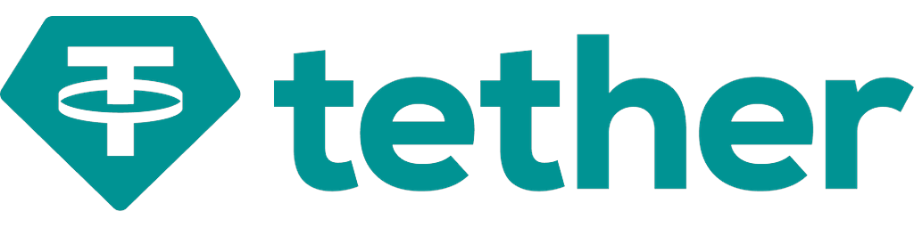
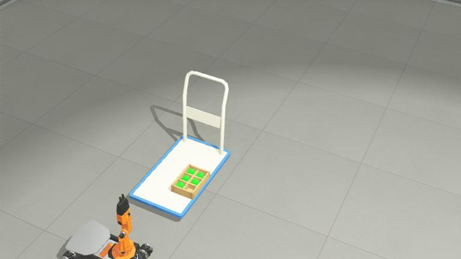
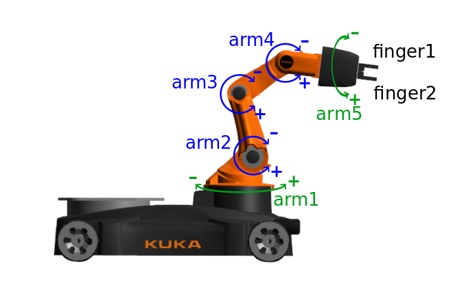
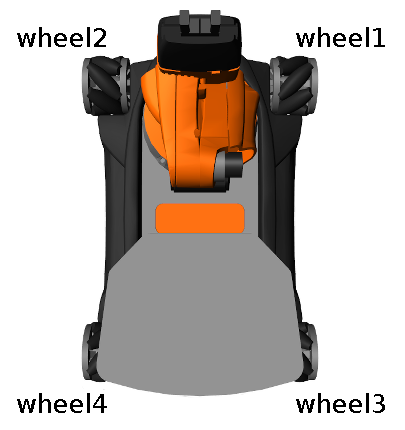
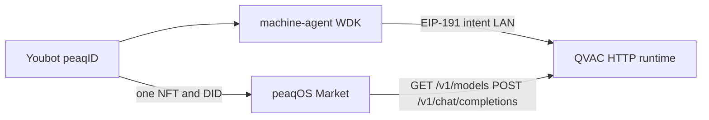

# Optimus

<p align="center">
  
</p>
Optimus is a robotics-as-a-service application built on QVAC and peaq. A factory robot needs private judgments (is the cold room safe, is the motor hot, is vibration a fault), but it has no GPU to run a model itself. QVAC on a laptop beside the line runs a local model, so the readings never leave the factory network. The robot holds its own keys through Tether’s Wallet Development Kit (WDK) and pays for each judgment, and peaq holds the robot’s identity.

A warehouse robot already produces the data a judgment needs: temperature, motor heat, and vibration. Sending that stream to a cloud model would export the factory’s data. QVAC avoids this by sitting on hardware the factory controls. It loads a local GGUF model (here, Llama 3.2 1B Instruct, Q4_0) and answers on the LAN. In this demo the gateway is the laptop in the Webots scene. It behaves like a Wi-Fi access point, except the service is private inference. Telemetry stays on the LAN and the result comes back to the robot.

A robot could carry its own GPU, but the cost would repeat for every robot on the floor, and the card would add power draw, heat, and weight to a battery-powered machine that only needs a judgment now and then. Most of the time it would sit idle. One laptop on the LAN can serve every robot in the plant, and updating the model means changing one machine instead of a whole fleet. An onboard GPU would keep the readings in the building too, so the reason to prefer a shared gateway is cost and reuse. It also gives the robot something to buy from, which is what makes per-judgment billing possible.

The project runs in the Webots robot simulator, which models real-world physics, so the robot’s movement, sensing, and pick-and-place behave as they would on a factory floor. The same architecture should work when deployed: a laptop running QVAC beside a physical robot, a wallet held by the robot, and an identity recorded on peaq.

This changes how robots are sold. Robots-as-a-service is growing fast, from an estimated $25B today to almost $70B by 2030, yet most of it runs on flat monthly leases. A robot that makes one delivery earns the same as one that makes a hundred, and speed, precision, and careful handling go unrewarded because the contract is a calendar, not a task. With QVAC, the robot can get a judgment (the room is out of range, the motor is hot) from hardware the plant controls, and WDK lets it pay for that judgment from a wallet it holds. The product becomes a private decision, settled in USDT, followed by the pick.

Manufacturing matters in Kenya, which is why this design fits. According to the Kenya National Bureau of Statistics Economic Survey 2025, manufacturing made up 7.3% of GDP in 2024 and employed about 369,200 people, or 11.5% of formal employment. A plant in Nairobi can put a laptop running QVAC next to the robot, keep temperature, vibration, and motor data in the building, and pay only when the robot asks for a judgment. That is a smaller commitment than an idle robot lease or a workflow that ships process data to a foreign cloud.
<p align="center">
  
</p>

<p align="center">
  
  &nbsp;
  
</p>

## How it fits together



| Role | In this repo | peaq identity |
|------|----------------|---------------|
| Machine | Webots Youbot + [`optimus_robot`](controllers/optimus_robot/optimus_robot.py) | **Only** `did:peaq:<decimal machine id>` |
| QVAC runtime | [`pnpm gateway`](packages/gateway) on the host / laptop proto | **None.** URL on the Youbot’s orchestrator record |
| Machine agent | [`@optimus/machine-agent`](packages/machine-agent) | Discovers QVAC, signs WDK intents, posts telemetry |

The laptop Display ([`optimus_kiosk`](controllers/optimus_kiosk/optimus_kiosk.py)) is the kiosk HUD: local GGUF alias, robot DID, `source` (rules vs model), latency, USDT quote, receipt. peaq RPC does **not** print in the Webots console.

### This demo machine (peaq mainnet)

Activated **Robot**, tier **entry**, Market status **active** and identity-verified.

| | |
|--|--|
| Owner | [`0x4360d54AdB797bf75013870de1AAD152839587D0`](https://peaq.subscan.io/account/0x4360d54AdB797bf75013870de1AAD152839587D0) |
| DID | `did:peaq:89559941402598656218897526255035006056145711259135012725567383558333737842803` |
| Market | `mach_0512f484e126` |
| QVAC endpoint | `mep_fa8adae44ba3` → `http://127.0.0.1:3030` (`GET /v1/models`) |
| Explorer | [machines.peaq.xyz](https://machines.peaq.xyz/machine/89559941402598656218897526255035006056145711259135012725567383558333737842803) |
| Activation tx | [peaqscan](https://peaq.subscan.io/tx/0x5f8383e6871f86fc5952128c96b5875e737c448edccc5ff47d5232e5900d6460) |

QVAC is registered with `PUT /machines/:machId/runtime-endpoints/qvac`. Hosted orchestration cannot actually probe localhost; loopback is for a laptop-side demo. A public or tunnel URL is required if peaqOS should call the runtime from the cloud.

## Two payment rails

1. **LAN (offline after models are cached).** Youbot → machine-agent → EIP-191 intent ([`@tetherto/wdk-wallet-evm`](packages/wallet)) → gateway `POST /infer`. Needs a BIP-39 `MACHINE_WALLET_MNEMONIC` and a stable `GATEWAY_PAYEE_ADDRESS`. No Sepolia ETH required for the kiosk.
2. **Online.** Scale USDT orders on peaq (Machine Market) after agent pairing. Optional Sepolia test USDT via [`pnpm settlement`](packages/settlement) is a separate WDK broadcast (`SEPOLIA_RPC`, `USDT_CONTRACT`).

Do not put the peaq private key in `MACHINE_WALLET_MNEMONIC`. WDK wants a seed phrase; peaqOS wants `PEAQOS_PRIVATE_KEY`.

## Prerequisites

- Node.js 22.17+ (`nvm use 22.23.4` is fine)
- pnpm 10.x (`corepack prepare pnpm@10.34.5 --activate`)
- Webots R2025a for the factory scene
- Python 3.10+ and `peaq-os-cli` 0.0.14+ only if you will activate or talk to Machine Market (this repo uses a gitignored `.peaqos-env` on Windows)

## Setup

```bash
pnpm install
pnpm -r build
cp .env.example .env
# MACHINE_WALLET_MNEMONIC = real 12-word phrase
# GATEWAY_PRIVATE_KEY = stable ethers key (empty means a new payee every start)
pnpm download-models   # online once; Llama 3.2 1B Instruct Q4_0
```

Copy `gatewayAddress` from `GET http://127.0.0.1:3030/health` into `GATEWAY_PAYEE_ADDRESS` (must match `GATEWAY_PRIVATE_KEY`).

For peaq: set `PEAQOS_PRIVATE_KEY` locally (never commit). After `peaqos activate`, set `MACHINE_ID` and `GATEWAY_DID` to the **same** robot DID. QVAC has no API key — `QVAC_ENABLED=1` and [`qvac.config.json`](qvac.config.json) are enough.

Start:

```bash
pnpm gateway              # QVAC GGUF, /quote /infer /v1/models /v1/chat/completions
pnpm machine-agent        # telemetry + WDK intent
pnpm --filter @optimus/dashboard dev   # optional WS feed on :5173
```

**Webots:** keep gateway + machine-agent up, open [`worlds/pick_and_place.wbt`](worlds/pick_and_place.wbt), Play. Details and overlay troubleshooting: [`docs/WEBOTS_CHANGES.md`](docs/WEBOTS_CHANGES.md).

## Offline demo

1. Gateway + machine-agent on LAN (models already cached).
2. Disable WAN.
3. `pnpm demo` or the dashboard scenario button, or Play in Webots.
4. `OPTIMUS_OFFLINE=1 pnpm offline-check` proves QVAC without network.

## Gateway HTTP

| Path | Use |
|------|-----|
| `GET /health` | `qvacReady`, `modelAlias`, `gatewayDid` (robot DID), `gatewayAddress` |
| `GET /v1/models` | peaqOS / OpenAI-shaped model list |
| `POST /v1/chat/completions` | peaqOS execute path (no WDK body; Scale pays on-chain) |
| `GET /quote` + `POST /infer` | LAN kiosk with WDK payment intent |

## Monorepo

Ledger and agent cache are JSON under `./data/` (gitignored).

| Package | Role |
|---------|------|
| `@optimus/shared` | Zod types + rules |
| `@optimus/gateway` | Embedded `@qvac/sdk`, quotes, infer, chat completions |
| `@optimus/machine-agent` | Telemetry, spend policy, WDK sign, `/telemetry` |
| `@optimus/wallet` | `@tetherto/wdk-wallet-evm` (not `wdk-main` core) |
| `@optimus/peaq-setup` | Online discovery cache for offline LAN |
| `@optimus/settlement` | Optional Sepolia USDT broadcast |
| `@optimus/dashboard` | Live decision feed |

## Docs

- [`docs/QVAC_INTEGRATION.md`](docs/QVAC_INTEGRATION.md)
- [`docs/WDK_INTEGRATION.md`](docs/WDK_INTEGRATION.md)
- [`docs/NETWORK_DEPENDENCIES.md`](docs/NETWORK_DEPENDENCIES.md)
- [`docs/WEBOTS_CHANGES.md`](docs/WEBOTS_CHANGES.md) — kiosk Display, HUD, asset junctions on Windows
- [`docs/ARCHITECTURE.md`](docs/ARCHITECTURE.md)
- [`docs/SUBMISSION.md`](docs/SUBMISSION.md)
