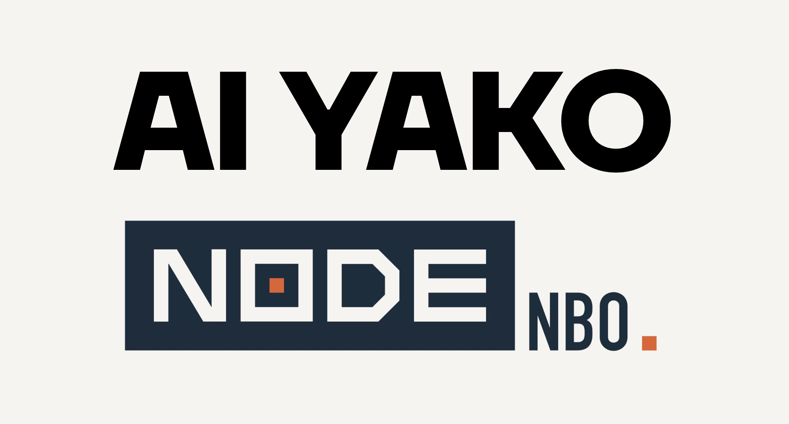
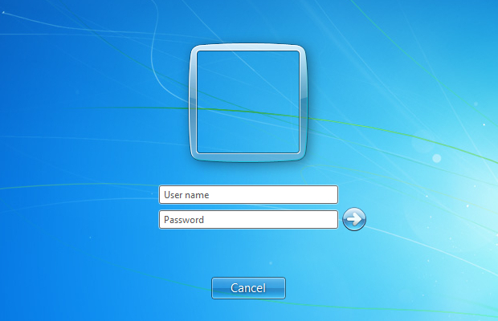
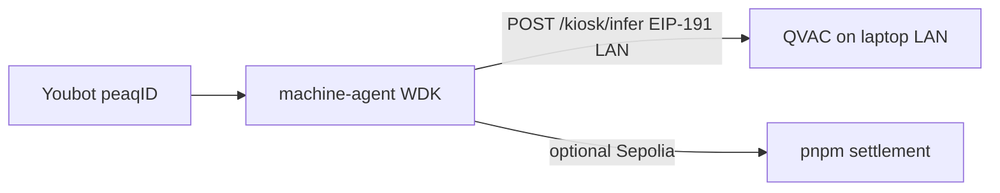

# Optimus: a factory robot that pays per inference for private, offline AI

  

  

**Optimus** is a robotics-as-a-service application built on **QVAC**, **Tether WDK**, and **peaq**. A **KUKA Youbot** in the **Webots** simulator drives to a laptop on the factory LAN, pays for an inference from a local QVAC model using its own wallet, and then completes its pick-and-place task.

  
  &nbsp;&nbsp;
  

---

## The problem

A factory robot needs decisions from a model: is the cold room safe, is the motor hot, is vibration a fault. It has no GPU on board, and sending its telemetry to a cloud model would export the plant’s operating data to a third party.

Most robots-as-a-service revenue also still comes from **flat monthly leases**. The market is growing from about **$25B** today to almost **$70B** by 2030, yet a robot that makes one delivery earns the same as one that makes a hundred. Speed, precision, and careful handling go unrewarded because the contract is a calendar, not a task.

Manufacturing is an important sector in **Kenya**. The **Kenya National Bureau of Statistics Economic Survey 2025** puts it at **7.3% of GDP** in 2024, with about **369,200** people employed, or **11.5%** of formal employment. Plants like these are a poor fit for idle robot leases and for workflows that ship process data to a foreign cloud. Optimus is designed for plants like these.

---

## How it works

**QVAC** runs on a laptop on the factory LAN. It loads a local GGUF model (**Llama 3.2 1B Instruct, Q4_0**) and answers on the network, much like a Wi‑Fi access point that serves **private inference**. A shared gateway also means **one machine can serve every robot** in the plant, which is cheaper than adding a GPU to each one.

**peaq** holds the robot’s identity. The Youbot has **one DID** and **one Machine NFT**. The laptop does not get a second Machine NFT.

The robot **pays once per inference**. At the kiosk, the Youbot calls **`POST /kiosk/infer`**, the machine agent requests a quote from the gateway, and **WDK** signs an **EIP-191 payment intent** naming the quote, payer, payee, USDT amount, and nonce. The gateway verifies the signature on the LAN, with **no RPC call**, before it returns the inference.

The receipt is settled on a test network. **`pnpm settlement`** uses the same wallet to broadcast a **Sepolia test USDT** transfer and writes the transaction hash onto the receipt.

The robot then returns to the conveyor and does the pick. The pick is the factory task and carries **no second charge**.

  

  <em>Live kiosk on the laptop — model alias, robot DID, source, latency, USDT quote, and receipt id (same story as the cyan HUD in Webots).</em>

The project runs in **Webots**, which models real-world physics, so the movement, sensing, and pick-and-place behave as they would on a factory floor. The same architecture should work on a physical robot: a laptop running QVAC beside it, a wallet held by the robot, and an identity recorded on peaq.

---

## Key features

| Feature | What it means |
|--------|----------------|
| **Private inference** | Temperature, motor heat, and vibration readings stay on the factory LAN. |
| **Offline operation** | Once model weights are cached, QVAC infer and WDK sign/verify need **no internet** (see [README — Proving QVAC offline](../README.md#proving-qvac-runs-without-internet-demo--checks)). |
| **Self-custodial payment** | Payer key from the robot’s own BIP-39 mnemonic via `@tetherto/wdk-wallet-evm` — separate from the peaq key. |
| **Pay per inference** | Starting the machine agent and periodic **`/telemetry`** sign nothing. Payment happens **once**, at the kiosk. |
| **On-chain machine identity** | **peaq** DID + Machine NFT for the Youbot. |
| **Live kiosk + HUD** | Laptop Display + matching 3D HUD: model, status, source, latency, cost, receipt id. |
| **Verifiable settlement** | Sepolia test USDT; **`txHash`** on the receipt in `data/gateway.json`. |

---

## Test payment

| Item | Value |
|------|--------|
| Network | Sepolia (test) |
| Token contract | `0x0F3a990cdDb2f3675372250a0D849B53528E60f8` |
| Payer (WDK) | [`0xF740BEA95f386350AD1F09242E8310Bf51E48D63`](https://sepolia.etherscan.io/address/0xF740BEA95f386350AD1F09242E8310Bf51E48D63) |
| Payee (gateway) | [`0x84f189AD39823D2C7C687249d0ccC677510A929e`](https://sepolia.etherscan.io/address/0x84f189AD39823D2C7C687249d0ccC677510A929e) |
| Amount | 0.01 USDT |
| Status | success |
| Transaction | [`0xb6b699dff5d6957ab7c96356c2f59b84b9302f9c30cb722b8aca83ad2cc6f460`](https://sepolia.etherscan.io/tx/0xb6b699dff5d6957ab7c96356c2f59b84b9302f9c30cb722b8aca83ad2cc6f460) |

Receipt **`1cc304eb-7bc3-464e-825f-cb2871e17533`** in `data/gateway.json` is settled with that hash. A second settled test transfer from the same wallet is [`0x5763361916e5c5ff977c78e37921cc5f58a2fb49199190ce25a189d6897a3efb`](https://sepolia.etherscan.io/tx/0x5763361916e5c5ff977c78e37921cc5f58a2fb49199190ce25a189d6897a3efb).

### Demo machine (peaq)

| | |
|--|--|
| DID | `did:peaq:89559941402598656218897526255035006056145711259135012725567383558333737842803` |
| Market | `mach_0512f484e126` |
| QVAC endpoint | `http://127.0.0.1:3030` |
| Explorer | [machines.peaq.xyz](https://machines.peaq.xyz/machine/89559941402598656218897526255035006056145711259135012725567383558333737842803) |

  

---

## Tech stack

| Layer | Technology |
|-------|------------|
| Inference | **QVAC** — local GGUF, `GET /v1/models`, chat completions, gateway `POST /infer` |
| Model | **Llama 3.2 1B Instruct** (GGUF, Q4_0) |
| Wallet | **Tether WDK** — `@tetherto/wdk-wallet-evm`, EIP-191 payment intents |
| Identity | **peaq** — machine DID and Machine NFT |
| Settlement | **Sepolia test USDT** — `pnpm settlement` |
| Simulation | **Webots** — KUKA Youbot factory floor |
| Runtime | **Node.js 22+**, **pnpm** — `pnpm gateway`, `pnpm machine-agent`, `pnpm settlement` |

---

## Related docs

- [README](../README.md) — setup, offline proof, API table  
- [MANUAL_TEST_GUIDE.md](./MANUAL_TEST_GUIDE.md) — repeat the E2E demo  
- [PROJECT_DESCRIPTION.md](./PROJECT_DESCRIPTION.md) — teleprompter and Notion paste  
- [SUBMISSION.md](./SUBMISSION.md) — track notes  
