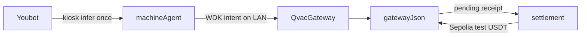

# Optimus

**Event:** AI Yako — “Your AI”. Node NBO, Nairobi. 24–31 October 2026 (EAT).  
**Track:** On-device agentic finance. QVAC for local AI. WDK for a self-custodial finance workflow.  
**Prize track:** 400 USDt.  
**Demo:** a KUKA Youbot in Webots hires a nearby QVAC gateway for a private factory judgment and pays with Tether WDK on Sepolia test USDT.

Paste this page into Notion.

---

## The project in one paragraph

Optimus is a QVAC application. A factory robot needs a private judgment — is the cold room safe, is the motor hot, is vibration a fault — and it has no GPU. QVAC on the laptop next to the line runs that model locally. The readings never leave the factory network. The same robot holds its own keys with Tether’s Wallet Development Kit and pays for that judgment. peaq holds the robot’s identity. The billable event is the judgment, not a monthly lease.

---

## The problem QVAC solves

A warehouse robot already produces the data a judgment needs: temperature, motor heat, vibration. Sending that stream to a cloud model exports the line. Running the model on the robot is not available, because the robot has no GPU.

QVAC is the missing machine. It sits on hardware the factory controls, loads a local GGUF (Llama 3.2 1B Instruct, Q4_0), and answers on the LAN. In this demo the gateway is the laptop in the Webots scene. It behaves like a Wi-Fi access point, except the service is private inference. Telemetry stays on the LAN. The result comes back to the robot.

That judgment is useful only if a machine can hire it without a person in the loop and without handing the wallet to a custodian. That is the WDK half of the same product.

---

## What WDK does

WDK is not the model and it is not peaq. It is the robot’s own wallet.

`@tetherto/wdk-wallet-evm` derives the payer from `MACHINE_WALLET_MNEMONIC`, a BIP-39 phrase. That phrase is not `PEAQOS_PRIVATE_KEY`. The robot keeps custody of the key that pays.

**Offline finance step.** When the Youbot reaches the laptop it calls `POST /kiosk/infer`. The machine agent asks the gateway for a quote, then signs an EIP-191 payment intent. The intent names the quote, the payer, the payee, the USDT amount, and a nonce. No RPC call is required to sign or to verify. The gateway checks the signature before it returns the QVAC judgment. Starting `pnpm machine-agent` does not sign anything. Periodic telemetry does not sign anything. Payment happens once, at the kiosk.

**Online test step.** `pnpm settlement` uses the same seed to broadcast a Sepolia **test** USDT transfer to `GATEWAY_PAYEE_ADDRESS` and writes the transaction hash onto the receipt. This step needs internet. It is a test environment. It is not mainnet USDT and it is not a peaq transaction.

### A successful test payment

Sepolia test USDT contract `0x0F3a990cdDb2f3675372250a0D849B53528E60f8`.  
Payer (WDK) `0xF740BEA95f386350AD1F09242E8310Bf51E48D63`.  
Payee (gateway) `0x84f189AD39823D2C7C687249d0ccC677510A929e`.  
Amount 0.01 USDT. Status success.

[0xb6b699dff5d6957ab7c96356c2f59b84b9302f9c30cb722b8aca83ad2cc6f460](https://sepolia.etherscan.io/tx/0xb6b699dff5d6957ab7c96356c2f59b84b9302f9c30cb722b8aca83ad2cc6f460)

Receipt `1cc304eb-7bc3-464e-825f-cb2871e17533` in `data/gateway.json` is `settled` with that hash. A second settled test transfer from the same wallet is [0x5763361916e5c5ff977c78e37921cc5f58a2fb49199190ce25a189d6897a3efb](https://sepolia.etherscan.io/tx/0x5763361916e5c5ff977c78e37921cc5f58a2fb49199190ce25a189d6897a3efb).

How a judge repeats it: `docs/MANUAL_TEST_GUIDE.md`. One settlement process. Fund the payer on Sepolia only.

---

## Why this changes robots-as-a-service

Private inference is what makes a different commercial model possible.

Robots-as-a-service is growing quickly. The Business Research Company estimates the market at about **$26.7 billion in 2025** and about **$67.9 billion in 2030**. Other analysts use a narrower definition and publish a much smaller number, so the spoken line stays approximate: about $25 billion today, almost $70 billion by 2030. The growth is not the point. The point is how the money is collected.

Most of that market still looks like a monthly lease. A robot that makes one delivery earns the same as a robot that makes a hundred. Speed, precision, and careful handling go unpaid, because the contract is a calendar, not a task.

QVAC makes the task billable without exporting the factory. The robot can prove a judgment — the room is out of range, the motor is hot — on hardware the plant controls. WDK lets the robot pay for that judgment from a wallet it holds. The product is no longer “a robot for thirty days.” The product is “a private decision, settled in USDT, then the pick.”

---

## Why a Kenyan factory is the right setting

This is not a claim that Optimus is deployed in Kenya. It is why the design fits the plants the hackathon is sitting next to.

A line in Nairobi can put a laptop running QVAC beside the robot. Temperature, vibration, and motor heat stay in the building. The robot pays only when it drives up and asks for the judgment.

Kenya National Bureau of Statistics, Economic Survey 2025:

| Fact | Figure |
|------|--------|
| Manufacturing growth, 2024 | 2.8% |
| Manufacturing share of GDP, 2024 | 7.3% |
| Formal manufacturing employment, 2024 | about 369,200 people |
| Share of formal employment | 11.5% |
| EPZ manufacturing investment, 2024 | up 5.6% to KSh 34.1 billion |
| Cumulative EPZ investment | KSh 171.9 billion |

Manufacturing employs a large share of formal workers on a modest share of GDP. Those plants are poorly matched to an idle robot lease, and they are poorly matched to a workflow that ships process data to a foreign cloud. A local QVAC kiosk plus a pay-per-judgment wallet is the smaller commitment: buy the inference when the robot needs it, keep the readings on site.

AI Yako is hosted with Node NBO in Nairobi, 24–31 October 2026. Remote teams are judged on the same criteria. The required evidence is the repository and a recorded demo that separates the offline AI from the test-network payment.

---

## Opportunity

Three pieces, in this order:

1. **QVAC** on the laptop. Local GGUF. `GET /v1/models` and chat completions for a peaqOS runtime record. The model host does not get a second Machine NFT. After the weights are cached, this half does not need the internet.
2. **peaq** on the Youbot only. One DID, one Machine NFT. The demo machine is `did:peaq:89559941402598656218897526255035006056145711259135012725567383558333737842803`, market `mach_0512f484e126`, QVAC endpoint recorded as `http://127.0.0.1:3030`.
3. **WDK** for the payment. EIP-191 intent on the LAN. Sepolia test USDT when a receipt is settled.

The shape matches the public Unitree G1 and QVAC story: one peaq identity, a paired agent, a nearby private model, a USDT payment. Optimus shows that shape with a KUKA Youbot in Webots, on a pick-and-place factory floor.

---

## How it is built

| Piece | Where | Job |
|-------|--------|-----|
| Youbot controller | `controllers/optimus_robot/optimus_robot.py` | Drive to the laptop, call `/kiosk/infer` once, then pick-and-place |
| Kiosk display | `controllers/optimus_kiosk/optimus_kiosk.py` | Draw model, DID, source, latency, price, receipt from `data/kiosk-status.json` |
| Machine agent | `packages/machine-agent` | Spend policy, WDK sign, `/telemetry` without payment, `/kiosk/infer` with payment |
| Wallet | `packages/wallet` | `WalletAccountEvm`. Sign offline. Broadcast only in `network.ts` |
| QVAC gateway | `packages/gateway` | Local model, quotes, infer, `/v1/models`, `/v1/chat/completions` |
| Settlement | `packages/settlement` | One test USDT transfer per pending receipt |
| Ledger | `data/gateway.json` | Quotes, nonces, receipts, `txHash` |

---

## How a run comes to life

**Setup, once, online.** Install, build, and `pnpm download-models` so the GGUF sits under the user profile in `.qvac/models`. Put the WDK mnemonic and the gateway payee in `.env`. Fund the payer with Sepolia ETH and test USDT. The Youbot DID is already the machine identity.

**QVAC comes up, offline.** `pnpm gateway` loads the cached GGUF. The log says `offline load from` a local file. `GET /health` returns `qvacReady: true`. No registry download. This is the offline AI feature.

**The agent waits.** `pnpm machine-agent` listens on port 4040. It does not pay.

**The robot moves.** Webots plays `worlds/pick_and_place.wbt`. The Youbot drives to the laptop kiosk. Only then does `pay_for_inference` post telemetry to `/kiosk/infer`.

**The judgment.** The agent signs the WDK intent. The gateway verifies it, runs the decision (rules first; the local model when the rules allow), and writes a receipt with `pending_settlement`. The laptop overlay shows the alias `llama-3.2-1b-instruct`, the robot DID, the source, the latency, 0.01 USDT, and the receipt. The robot then returns to the pick-and-place path. Later telemetry posts do not create new payments.

**The test payment.** One `pnpm settlement` process sees the receipt, broadcasts the Sepolia transfer, and stores `txHash`. That is the network action. Show the explorer page in the demo video after the offline gateway shot.

---

## What needs the internet

| Works offline after the model is cached | Needs the internet |
|------------------------------------------|--------------------|
| QVAC load from the local GGUF | First `pnpm download-models` |
| `/health`, `/quote`, `/infer` | Sepolia RPC inside `pnpm settlement` |
| EIP-191 sign and verify | Optional peaq Machine Market calls |
| Webots drive, kiosk HUD, pick-and-place | |

Disconnect WAN for the QVAC half. Turn the network back on only for the Sepolia settlement, and say that on camera.

---

## Teleprompter

Read this while the demo plays. Times are beats, not a locked edit. Lines under “On screen” are cues, not words to say. Do not show `.env` or the seed phrase.

The controller still drives to the laptop first, then the belt. The 1:05 line says the Youbot starts toward the cube and turns back for the judgment. Use that line only if the take shows it.

Local model file to point at: `C:\Users\Omen\.qvac\models\f2bade0bc5cd4a8c_Llama-3.2-1B-Instruct-Q4_0.gguf`.

**0:00 — the project**  
With QVAC, a factory robot can hire private inference from the machine next to it, and the inference stays on the LAN. This orange Youbot is the factory machine. It is registered on peaq, a blockchain built for machines, which gives each one its own on-chain identity. The laptop beside the crate is the QVAC gateway.

**0:08**  
The robot has telemetry: temperature, motor heat, and vibration. It needs a decision, and it has no GPU on board. These readings show how the plant is running, including when equipment is under strain and when a cold room drifts out of range. Sent to a cloud model, they leave the building and a third party holds them. Here the numbers stand in for a cold room, and they travel only as far as this LAN.

**0:18**  
QVAC on the laptop is the compute access point. The model runs locally, on hardware the factory controls, and one machine on the LAN can serve every robot in the plant, which is cheaper than adding a GPU to each one. That display is the live kiosk: QVAC local, Llama 3.2 1B Instruct, ready, DID, telemetry stays on LAN. The cyan text at the top left of the 3D view shows the same status, in case the lid folds.

**0:28**  
This is also how the robot becomes a service. Robots-as-a-service is growing from about twenty-five billion dollars today toward almost seventy billion by 2030, yet most of it is still a flat monthly lease. A robot that makes one delivery earns the same as one that makes a hundred, so speed and care go unpaid.

**0:40 — Wi-Fi off, gateway from disk**  
On screen: Wi-Fi off. Terminal: `pnpm gateway`.

To show the model never leaves the building, Wi-Fi is off. The gateway still starts. The log says offline load from a local file, the Llama 3.2 1B Instruct GGUF already on this computer. No registry download. No Hugging Face. The factory is serving its own model.

On screen: File Explorer on `C:\Users\Omen\.qvac\models\…Llama-3.2-1B-Instruct-Q4_0.gguf`.

That file is the model. The gateway is reading it from disk.

**0:55 — agent and the live judgment feed**  
On screen: second terminal, `pnpm machine-agent`. Third terminal, `pnpm watch-infer`.

The machine agent is the robot’s side of the LAN. It does not pay just because it started. Watch-infer sits on the gateway and will print the judgment when the Youbot actually hires it. Still no internet. Still no chain call.

**1:05 — cube, then back for the judgment**  
On screen: Webots Play. Youbot starts toward the cube, then turns back toward the laptop.

On Play, the arm stays tucked. The mecanum wheels take the Youbot toward the cube on the belt. It does not pick yet. It does not have the judgment, so it backtracks to the laptop, north of the crate, without clipping it. The overlay says driving to laptop kiosk. Pay for nearby QVAC inference.

**1:18 — three pieces**  
Three pieces make this work together. peaq gives the robot a verifiable identity: one DID and one Machine NFT. QVAC gives it private inference on the LAN. Tether’s WDK gives it a wallet it controls, so it can pay without a custodian. The same shape appears in the public Unitree G1 and QVAC demo, where a robot with a peaq identity pays a nearby private model in USDT. Optimus bills per inference instead of per month.

**1:32 — one payment, still on the LAN**  
It pays once, in USDT, through Tether WDK, from the robot’s own wallet. The intent is signed here on the LAN, before any chain call. The Youbot stops at the laptop with its wheels still, and that pause is the one payment. The display moves from requesting a quote to signing the intent.

**1:44 — receipt**  
The inference returns and the receipt is written, with the telemetry still on the LAN. The display fills in source, latency in milliseconds, one cent of USDT, and a short receipt id. The cyan HUD updates to the same model line.

**1:52 — watch-infer**  
On screen: the watch-infer terminal.

QVAC local model judgment. Status ok. Source model, Llama via QVAC. Latency about 908 milliseconds. Reason: motor temperature exceeds the safe limit. Action: escalate. Receipt `15fc685d-2c7c-4eaa-ac17-02ee381709f2`.

That is the private decision. The model ran on the laptop. The readings did not leave the LAN. Wi-Fi is still off.

**2:05 — Wi-Fi on, settlement**  
On screen: Wi-Fi on. Terminal: `pnpm settlement`. Then Sepolia Etherscan.

Settlement is the part that needs the network, and it runs in a test environment. Wi-Fi comes back on. One settlement process broadcasts the test USDT. Here is the transaction. Payer 0xF740…8D63. Payee 0x84f1…929e. One cent of test USDT, not a dollar and not mainnet. Status success.

On screen: [0x204e757d662d38ff3674a61703179bfd1dc2db407e9a321543c04d4f17d3cae4](https://sepolia.etherscan.io/tx/0x204e757d662d38ff3674a61703179bfd1dc2db407e9a321543c04d4f17d3cae4).

That hash is this receipt. The same wallet sent it. The gateway address received it.

**2:20 — the pick, no second charge**  
Back on the floor, the overlay says paid, driving back to the belt. The Youbot crab-walks to the pick start, drives to the conveyor, and closes the gripper on the cube. The pick is the factory task and carries no second charge.

**2:32 — close**  
The inference is private and stays on the factory LAN, and the payment for it is self-custodial. The robot started toward the cube, turned back, hired the laptop, paid once, and then did the pick. The charge follows the decision it needed instead of the months it sat on the floor.

---

## Demo video checklist

1. Gateway log: `offline load from` a local `.gguf`, then `/health` with `qvacReady: true`. WAN can be off for this shot.
2. Webots: Youbot drives to the laptop. Kiosk shows the model, the DID, and the receipt. Say that telemetry stayed on the LAN.
3. Settlement log: `Settled` plus a hash. Cut to the Sepolia explorer. Say “test network.”
4. Do not show `.env`, the seed phrase, or the peaq private key.

---

## Submission checklist

| Item | Where |
|------|--------|
| Repository | This repo. Do not commit `.env` |
| Offline QVAC | Gateway health and local GGUF load, in the video |
| Test payment | Sepolia tx link above, or a fresh one from your run |
| QVAC code | `packages/gateway/src/adapters/qvac-adapter.ts` |
| WDK sign | `packages/wallet/src/wallet-adapter.ts` |
| WDK broadcast | `packages/wallet/src/network.ts`, `packages/settlement/src/worker.ts` |
| Kiosk pay once | `controllers/optimus_robot/optimus_robot.py` |
| Repeat the demo | `docs/MANUAL_TEST_GUIDE.md` |

---

## What this is not

- Not a live deployment in a Kenyan factory. The Kenya figures explain the fit.
- Not mainnet USDT. Settlement is Sepolia test USDT.
- Not a peaq transaction on the infer path. The Youbot DID is identity. The USDT transfer is WDK on Sepolia.
- Not a payment every time the agent starts, and not a payment on every telemetry post.
- A quote row in `gateway.json` is not a payment. Only a receipt that settlement marks `settled` is a payment.

---

## Sources

- Robotics-as-a-service market size: The Business Research Company, about $26.72 billion in 2025 and $67.85 billion in 2030. [Report](https://www.thebusinessresearchcompany.com/report/robotics-as-a-service-raas-global-market-report). Other firms publish smaller totals under a narrower definition.
- Kenya manufacturing: Kenya National Bureau of Statistics, Economic Survey 2025. Manufacturing grew 2.8 percent in 2024 and contributed 7.3 percent of GDP. Formal manufacturing employment was 369.2 thousand, 11.5 percent of formal employment. EPZ manufacturing investment rose 5.6 percent to KSh 34.1 billion. Cumulative EPZ investment KSh 171.9 billion.
- peaq and QVAC on machines: [peaq brings QVAC to robots](https://www.peaq.xyz/blog/peaq-brings-qvac-by-tether-to-robots-and-machines-enabling-private-ai-inference-at-the-edge).
- Demo machine: [machines.peaq.xyz](https://machines.peaq.xyz/machine/89559941402598656218897526255035006056145711259135012725567383558333737842803).
