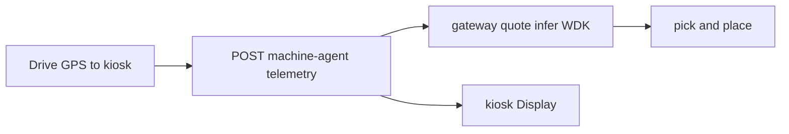

# Webots changes

- **Webots version:** R2025a (`#VRML_SIM R2025a` in [worlds/pick_and_place.wbt](../worlds/pick_and_place.wbt))
- **Robot:** KUKA Youbot pick-and-place benchmark
- **Unchanged:** [controllers/pick_and_place/pick_and_place.py](../controllers/pick_and_place/pick_and_place.py)
- **Added:** [controllers/optimus_robot/optimus_robot.py](../controllers/optimus_robot/optimus_robot.py) — drive to laptop kiosk, pay for inference via machine-agent, then pick-and-place
- **Added:** [controllers/optimus_kiosk/optimus_kiosk.py](../controllers/optimus_kiosk/optimus_kiosk.py) — renders payment status on the Laptop proto `Display` (`DEF OPTIMUS_LAPTOP`)

**Signals:** joint positions from arm sensors (real). `tempC`, `motorTempC`, `vibrationMmS` are **synthetic** (documented in README).

## Laptop kiosk demo (drive → pay → pick)

The scene laptop (`DEF OPTIMUS_LAPTOP`) is the **machine terminal**. Its controller **`optimus_kiosk`** polls [`data/kiosk-status.json`](../data/kiosk-status.json) (written by `optimus_robot`; the file is gitignored at runtime) and draws quote/receipt text on the built-in `display` device.

1. Start **gateway** + **machine-agent** on the host; set valid `MACHINE_WALLET_MNEMONIC` and `GATEWAY_PAYEE_ADDRESS` in `.env`.
2. Open [worlds/pick_and_place.wbt](../worlds/pick_and_place.wbt) — Youbot uses controller **`optimus_robot`** (already set in the world file).
3. Press Play: Youbot drives to the kiosk (`GPS` + `InertialUnit`), pays (agent → WDK-signed intent → gateway `/infer`), kiosk shows status/quote/receipt, then the benchmark pick-and-place runs.

**Env (Webots controller):** `MACHINE_AGENT_URL` (default `http://127.0.0.1:4040/telemetry`), `MACHINE_ID`, `OPTIMUS_CONTEXT`. Optional: `KIOSK_TARGET_X/Y` (defaults `-2.10`, `-1.15` — north of the 0.6 m crate). After payment the Youbot crab-walks back to the benchmark spawn `(-2.4, 0)`, then the conveyor leg is the original 520-step drive at 7 rad/s. The laptop lid runs `optimus_kiosk` and reads `data/kiosk-status.json` onto its built-in `display`.

**Reference benchmark:** [controllers/pick_and_place/pick_and_place.py](../controllers/pick_and_place/pick_and_place.py) unchanged.

**Logo:** `DEF LOGO` on the factory machine uses [worlds/textures/factory_logo.png](../worlds/textures/factory_logo.png) instead of the sample `webots://` ladybug texture. The PNG background is transparent. The plane size is `1.16 0.25`; translation is `-0.76 0.138 0.79`.

## Asset path (dark scene)

[worlds/pick_and_place.wbt](../worlds/pick_and_place.wbt) is the R2025a template and was not rewritten. It loads the Youbot, factory, floor, and textures through `webots://` URLs, which resolve only under `C:\Program Files\Webots\projects`. That install shipped without the project protos, so Webots skipped `Youbot`, `TexturedBackground`, `Floor`, and the factory nodes and the view stayed black.

The full assets are in `webots-master\projects`. Each missing `protos` folder (and `default\worlds` textures, meshes, and sounds, plus the pick-and-place world textures) is a directory junction from the install path to that tree. With those links in place, the Optimus world shows the factory sky, concrete floor, conveyor, and orange Youbot from the world's viewpoint (`exposure 1.5`). Creating the junctions needs an elevated shell; `mklink /J` into Program Files is denied otherwise.
