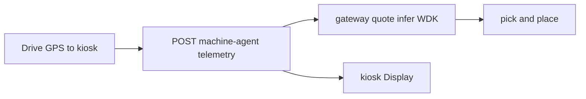

# Webots changes

- **Webots version:** R2025a (`#VRML_SIM R2025a` in [worlds/pick_and_place.wbt](../worlds/pick_and_place.wbt))
- **Robot:** KUKA Youbot pick-and-place benchmark
- **Unchanged:** [controllers/pick_and_place/pick_and_place.py](../controllers/pick_and_place/pick_and_place.py)
- **Added:** [controllers/optimus_robot/optimus_robot.py](../controllers/optimus_robot/optimus_robot.py) — drive to laptop kiosk, pay for inference via machine-agent, then pick-and-place
- **Added:** [controllers/optimus_kiosk/optimus_kiosk.py](../controllers/optimus_kiosk/optimus_kiosk.py) — renders payment status on the Laptop proto `Display` (`DEF OPTIMUS_LAPTOP`)

**Signals:** joint positions from arm sensors (real). `tempC`, `motorTempC`, `vibrationMmS` are **synthetic** (documented in README).

## Laptop kiosk demo (drive → pay → pick)

The scene laptop (`DEF OPTIMUS_LAPTOP`) is the **nearby QVAC gateway terminal** (Youbot has no GPU). Its controller **`optimus_kiosk`** polls [`data/kiosk-status.json`](../data/kiosk-status.json) and draws **live local model runtime**: `llama-3.2-1b-instruct`, `qvacReady`, `source` (`model` vs `rules`), `latencyMs`, `gatewayDid`, USDT quote, and truncated `receiptId`.

1. Start **gateway** + **machine-agent** on the host; set valid `MACHINE_WALLET_MNEMONIC` and `GATEWAY_PAYEE_ADDRESS` in `.env`.
2. Open [worlds/pick_and_place.wbt](../worlds/pick_and_place.wbt) — Youbot uses controller **`optimus_robot`** (already set in the world file).
3. Press Play: Youbot drives to the laptop, pays (agent → WDK-signed intent → gateway `/infer` on this host’s QVAC GGUF), the Display shows model / DID / source / latency / receipt, then pick-and-place runs.

**Env (Webots controller):** `MACHINE_AGENT_URL` (default `http://127.0.0.1:4040/telemetry`), `MACHINE_ID`, `OPTIMUS_CONTEXT`. Optional: `KIOSK_TARGET_X/Y` (defaults `-2.10`, `-1.15` — north of the 0.6 m crate). After payment the Youbot crab-walks back to the benchmark spawn `(-2.4, 0)`, then the conveyor leg is the original 520-step drive at 7 rad/s. The laptop lid runs `optimus_kiosk` and reads `data/kiosk-status.json` onto its built-in `display`.

**Reference benchmark:** [controllers/pick_and_place/pick_and_place.py](../controllers/pick_and_place/pick_and_place.py) unchanged.

**Logos:** `DEF LOGO_PANEL` on the factory machine holds three coplanar textures with **local** offsets (QVAC above, Tether center, AIyako below) so spacing follows the sign face, plus small local Z steps to avoid z-fighting. Webots uses `qvac-logo.png` (from [qvac-logo.svg](../worlds/textures/qvac-logo.svg)).

## Overlays

| Surface | How it updates |
|---------|----------------|
| Laptop **Display** (620×400) | Live **QVAC local** runtime (model alias, ready, DID, source, latency, USDT, receipt). Cyan overlay in [worlds/.pick_and_place.wbproj](../worlds/.pick_and_place.wbproj). |
| 3D HUD labels | `QVAC llama-3.2-1b-instruct \| source \| Nms`, Youbot / cube / laptop poses. |
| Benchmark robot window | `WorldInfo.window` and `PickAndPlaceBenchmark.window` = `pick_and_place` (Overview / Metrics / Instructions). |
| Generic robot windows | Youbot, laptop, conveyor belt, Jetson Nano use `window "<generic>"`. Perspective `robotWindow:` opens them on load. |
| Factory logos | Static `DEF QVAC_LOGO` / `DEF LOGO` / `DEF AIYAKO_LOGO` textures, not a Display. |

Reload the world after changing `.wbproj`. In the 3D view: **Overlays** menu → show Display (and Camera / RangeFinder if those devices exist). Do not hide **View → Overlay**.

Do not use MCP **Save World** after Play: it writes runtime poses (cube, conveyor, `mcp_bridge`) and breaks pick-and-place.

## Troubleshooting (laptop screen blank)

1. **Lid vs Display.** The proto hinge has no motor; gravity can fold the lid. Status still draws on the `display` device and on the HUD labels. Look at the inner lid face and the top-left overlay.
2. **Status file.** Default `data/kiosk-status.json` (gitignored). Override with `OPTIMUS_KIOSK_STATUS_PATH` or `OPTIMUS_REPO_ROOT`. The Youbot flushes/fsyncs writes so Windows sees them immediately.
3. **Payment text.** Start gateway + machine-agent; otherwise the kiosk shows idle then “Agent unreachable”.
4. **Benchmark Metrics tab empty.** Confirm `PickAndPlaceBenchmark` is in the world and the console does not say `robotbenchmark module not found` (needs `WEBOTS_HOME` / project junctions as below).

## End-to-end terminals (what prints where)

Start **three** processes, then Webots Play. The laptop overlay shows **this machine’s** QVAC model, not peaq RPC.

| Surface | Command | What you see |
|---------|---------|----------------|
| **QVAC load / infer** | `pnpm gateway` | `[QvacAdapter]` fit/download, Fastify `/quote` `/infer` |
| **Health / DID / model** | `curl http://127.0.0.1:3030/health` | `qvacReady`, `modelAlias`, `gatewayDid`, `gatewayAddress` |
| **WDK pay** | `pnpm machine-agent` | Quote, signed intent, `/telemetry` |
| **Decision feed** | `pnpm --filter @optimus/dashboard dev` | WS `decision.source` (`rules` vs `model`), receipt DID |
| **peaq (online)** | `@optimus/peaq-setup` CLI | `Cached gateway discovery for offline use` — **the peaq console** |
| **On-chain USDT (online)** | `@optimus/settlement` | Tx hash when not `OPTIMUS_OFFLINE` |
| **Webots console** | Controllers | Nav / kiosk path — not peaq RPC |
| **Laptop Display** | Overlay | Local GGUF alias, DID, source, latency, quote, receipt |

peaq DIDs in the overlay (`did:peaq:gateway-local`) are JSON on the LAN. Machine Market / on-chain coordination is the **online** setup and settlement path only.

## Asset path (dark scene)

[worlds/pick_and_place.wbt](../worlds/pick_and_place.wbt) is the R2025a template and was not rewritten. It loads the Youbot, factory, floor, and textures through `webots://` URLs, which resolve only under `C:\Program Files\Webots\projects`. That install shipped without the project protos, so Webots skipped `Youbot`, `TexturedBackground`, `Floor`, and the factory nodes and the view stayed black.

The full assets are in `webots-master\projects`. Each missing `protos` folder (and `default\worlds` textures, meshes, and sounds, plus the pick-and-place world textures) is a directory junction from the install path to that tree. With those links in place, the Optimus world shows the factory sky, concrete floor, conveyor, and orange Youbot from the world's viewpoint (`exposure 1.5`). Creating the junctions needs an elevated shell; `mklink /J` into Program Files is denied otherwise.
