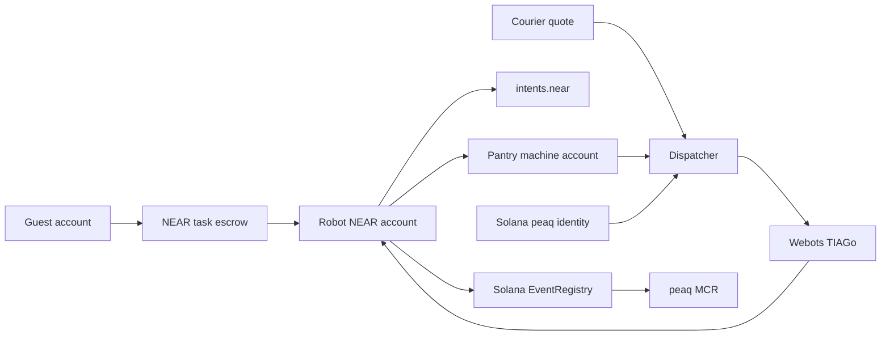

# Hotel Robot-as-a-Service on NEAR

Design write-up for the NEAR hackathon. This file is the product argument, not the contract source. The simulation already exists: [`worlds/kitchen.wbt`](../worlds/kitchen.wbt) and [`controllers/mission_control/mission_control.py`](../controllers/mission_control/mission_control.py). Judge-facing do-X-see-Y steps live in the repo [README](../README.md).

## What this is

The peaqOS plus LG CLOi demo showed a hotel robot earning an onchain payment for one skill: a guest orders room service, a dispatcher picks a ServeBot, telemetry proves delivery, and an embedded wallet settles without a person. That demo used Tether’s Wallet Development Kit and USDT.

This project keeps the product and changes the settlement stack. A guest orders an item in the Webots kitchen. The TIAGo robot performs one priced skill. A single NEAR contract holds the funds and pays the robot's NEAR account when that same account reports the job done. NEAR Intents is how the robot can then move USDT to another chain. Solana, through peaqOS, holds who the robot is and its credit history. There is no Tether wallet and no per-chain task escrow.

The kitchen is the hotel. Hospitality language is the wrapper. The product is pay-per-skill robotics, and the robot is also a customer: after it is paid, it pays the pantry machine for the jar and keeps the spread.

## Physical AI thesis

Software agents already transact on NEAR. The next wave of agents will be physical AI: robots that do work in the real world. This demo is that wave on the same stack: a TIAGo that earns, spends, and settles.

### What NEAR actually is

NEAR did not start as a DeFi chain and later bolt on AI. Illia Polosukhin co-authored *Attention Is All You Need*. Alexander Skidanov came from production distributed databases. The project began as AI tools and a way to build apps from natural language, then became a sharded L1 because trusted execution, verifiable coordination, and scalable state are the same problems. That history is why the stack now looks like a commerce layer instead of a swap venue: Nightshade for execution, Chain Signatures so a NEAR account (including a contract) can sign on other chains, Intents so a user or agent states an outcome instead of a route, confidential intents and a live private shard for trades that cannot sit on a public mempool, Shade Agents and NEAR AI (TEE inference, IronClaw, Agent Market) for software that acts, and House of Stake plus a live Intents fee switch so usage can buy back `$NEAR`.

NEAR is building the open monetary layer for agents that already move value. The next wave of those agents is physical AI (robots). If that layer is missing, robots stay on monthly leases and closed wallets.

Public numbers (date them; do not treat any one figure as a league table):

- Intents all-time volume: the essay and Brave (March 2026) say $14B+ across 35+ chains and 19M+ swaps. NEAR's Q2 2026 state-of-the-network post puts cumulative volume above $20B. Later July 2026 reporting on the revenue dashboard puts it around $23B, with roughly $38M gross fees and about $8.6M net protocol revenue. Short copy: more than $14B, and still compounding through 2026.
- Fee switch: live since late February 2026. Protocol fee is tiny by design. Distribution fees split with frontends. Payouts denominated in `$NEAR`. Early official note: over 1M `$NEAR` already directed to buybacks. near.com is the owned frontend: Q2 2026, about $209M trailing-30-day volume, ~10% of Intents flow, and 42% of its swaps in confidential mode with confidential TVL past $30M.
- Protocol: 5+ years, 100% uptime claimed, inflation cut 5% to 2.5% (30 Oct 2025), fully unlocked supply, House of Stake on mainnet. Nightshade 3.0 (NEARCON 2026) separates consensus from execution, adds atomic cross-shard transactions, and a live private shard.
- Product proof for humans: near.com, one account, 35+ chains, confidential cross-chain execution. TravAI is the cited agent that already pays with any asset while Intents does the hops.

Do not write "NEAR is the number one blockchain for AI" as an unattributed ranking. Write the claim NEAR itself makes, then show why this project extends it.

### The gap: software agents versus physical AI (robots)

A software agent can already, on this stack, express "pay this invoice in whatever token I hold" and let Intents find the path. That is the agentic-commerce thesis. It is still incomplete. Most economic work is not a swap. It is a jar moved from a counter to a table, a floor cleaned, a pallet picked, a room restocked. Those actions are done by physical AI: robots with sensors, a deadline, and a payment that waits on proof the robot finished the job, not proof of a solver fill.

| | Software agent | Physical AI (robot) |
| --- | --- | --- |
| Where it runs | TEE or laptop | Kitchen, warehouse, hotel |
| What it spends on | APIs, inference, swaps | Skills and other machines (power, parts, inventory) |
| When it settles | Seconds | When telemetry shows the job is done |
| How it fails | Bad JSON payload | Missed drop or empty battery |

The infrastructure requirements Illia lists for the next internet (interoperable, confidential, verifiable, economically sustainable, credibly neutral) do not change for robots. They get stricter. A robot cannot hold a custodial WDK forever, cannot wait on a manager to buzz, and cannot be billed a flat lease when it ran three deliveries in a slow week. It needs an account, a policy-bound key, an escrow that refunds on timeout, a way to pay another machine, a reputation file, and an exit into the asset the operator actually wants (USDT, USDC, SOL). That is this project's stack. NEAR already has the money and identity rails. Webots is the robot in simulation.

### Markets: cite the range, do not pick a single brochure number

Estimates disagree because they mix industrial arms, AMRs, humanoids, and managed service contracts. That is stated up front; the numbers below are bands.

- **Robotics-as-a-Service.** The Business Research Company: $26.72B in 2025, $32.08B in 2026, $67.85B in 2030, ~20.6% CAGR, with pay-per-use named as a forecast trend. NextMSC: $33.62B in 2025 to $76.59B in 2030. Grand View Research (narrower): $4.2B in 2025 to $23.3B in 2030. Inside Robotics: $2.8B in 2024 to $18.4B in 2030. Even the tight definitions are high-teens to 40% CAGR; the broad service definitions land near $70B by 2030. peaq's CLOi write-up used ~$25B today and ~$70B by 2030; that sits inside TBRC/NextMSC, not GVR.
- **Physical AI plus RaaS as a named category.** Research and Markets: ~30.8% CAGR 2025–2030, about $21B of incremental value in that window. Treat as a growth-rate cite, not a stock of the whole robotics industry.
- **General-purpose / embodied robots.** McKinsey: market under $1B today, about $370B by 2040 in the base case, ~50% of that value in China, lead uses warehouse logistics, light manufacturing, retail, agriculture, healthcare. That is the jump from a robot that does one programmed job to physical AI that can take a new task. This demo is the payment rail for that class of robot, not a humanoid hardware claim. Do not treat $370B as 2030 RaaS.
- **Hospitality robots.** TBRC: $0.7B in 2025 to $2.13B in 2030, 24% CAGR. Parallel estimates ~$0.65B in 2024 to ~$2.2B in 2030. Delivery robots are the fast slice (~26% CAGR in one segmentation). Marriott and Hilton already run Relay/Savioke amenity delivery. The kitchen world is that slice: room-service delivery, not a lobby Pepper.
- **Hotels already in the field.** peaq's CLOi piece estimates more than 10,000 hotels with some robot (delivery or cleaning). That is an industry estimate from that demo, not a census. The bodies are deployed; the billing is still a lease.

The contrast: a $70B RaaS market billed as capacity, versus the same robots billed as skills. peaq argued flexible pricing could 3x the addressable set of buyers. This project does not need that multiple to be true. It needs one hotel to pay for `fetch_honey` and one pantry to get paid for the jar.

### Closed RaaS versus open machine commerce

Today's RaaS: the hotel signs a monthly contract, pays for idle hours, cannot buy a premium skill a la carte, and the manufacturer cannot price that skill except by stuffing it into the bundle. The robot has no account. The pantry has no account. Value moves in an ERP.

Agentic software on NEAR: the user or agent states an outcome, Intents searches counterparties, settlement is atomic, optional confidentiality, fees can buy `$NEAR`.

Physical AI on NEAR, this project: the guest states "honey on the table," the dispatcher picks a robot, the NEAR task escrow holds the funds, the TIAGo fetches, `complete` pays the robot, `pay_supplier` pays the pantry, a refused courier quote sits on the receipt, Intents can take the robot's spread to USDT, peaq on Solana stores who the machine is and what it has earned.

That last loop is the missing product. TravAI abstracts chains for a software travel agent. This demo abstracts chains for physical AI: a robot with GPS. near.com is one account for a human across 35 chains. The TIAGo is one Ed25519 key across NEAR (settlement), Solana (identity), and Intents (exit). If AI is the final UI, the important layer is the monetary coordination underneath. Physical AI does not present a UI to the guest. The coordination layer is the product.

### Why this has to be NEAR, not a WDK on the robot

The LG CLOi plus peaq plus Tether WDK demo proved pay-per-skill in a hotel sim with USDT in an embedded wallet. Keep that as the sibling, not the enemy. What it does not give a NEAR jury:

- One escrow that is not redeployed per chain.
- Chain Signatures so a contract can act on Solana without a hot key on a server.
- Intents so the robot does not have to hold the guest's asset.
- Function-call keys so the controller cannot drain the account, only `complete` and `pay_supplier`.
- Named testnet accounts a judge can click.
- Agent Market as a storefront whose deliverable is the onchain receipt.
- A usage-to-value path: every skill that settles through Intents is the same fee switch that already funds buybacks. Physical volume is a new flow into an engine that is already on.

A closed WDK is a wallet in the torso. An open monetary layer is an account that can hire, be hired, refund a guest, and cash out. That is user ownership for a machine.

### Pitch lines (X post and submission `idea` field)

1. Software agents on NEAR already move value across 35+ chains. The next wave of agents will be physical AI (robots).
2. Hotels should pay for the delivery, not the month. The robot should pay the pantry for the jar, not file an invoice.
3. NEAR is the settlement substrate; Intents is the exit; peaq on Solana is the name and the credit file; Webots is the robot in simulation. Together that is physical AI as a market participant.
4. If NEAR is the commerce layer for agents, it is unfinished until a robot can complete a job and pay another machine without a human in the loop.

## Hackathon tracks

Development ends 2026-11-14T23:59:00Z. One submission, several tracks. Prizes are per track. The README is written as do-X-see-Y steps because Claude and Codex screen reproducibility before the human jury.

Submit these ids:

- `agents` — primary. The robot earns, spends inside a budget, hires the pantry, counters one high quote, and keeps a receipt. Hints in play: agent commerce, NEAR Intents, chain signatures. The track prompt asks for a contractor that breaks a job into parts, pays others, and stays inside a budget.
- `business` — the hotel runs procurement and a revenue split from one config file. A human sets the max price, the pantry share, and a kill switch. The robot's key is a function-call key, which is the option the business prompt allows in place of OutLayer. OutLayer is skipped.
- `realworld` — a hotel pays a stablecoin invoice for one delivery. Intents is the rail that lets the robot end in USDT. Testnet-only is allowed; Intents stays mainnet because no testnet exists (Q-007, Q-010).
- `swarms` — two machine accounts quote, the dispatcher picks one, the winner pays the supplier. That is a coordination market with one robot in the simulator and a second account on chain.
- `open` — fifth. The official prompt says you can enter Open Innovation next to any other track. What that jury is asked to look for is “something we haven’t seen”: money, intelligence, and ownership in one loop, plus chain abstraction. **The new primitive in one sentence: one NEAR escrow for a machine whose identity lives on another chain, with the robot as both seller and buyer.**

Leave these off the form. The demo does not do the thing the track is judged on: `defi`, `privacy`, `thesis`, `games`, `memecoins`, `social`. `security` is the closest miss. The scoped key belongs in the business and agents story. A separate security-track entry needs a policy engine and scam checks this build does not have.

`nfts` stays off unless a NEP-171 robot token is added. The track prompt is specific: an NFT as a NEAR account (NEP-141 plus a sub-account that holds money, royalties or access, and that wallet moves on transfer). The peaq Machine NFT is a real token, but it lives on Solana, it is not NEP-171, and selling it does not move the NEAR escrow wallet.

Agent Market (`market.near.ai`) is the extra NEAR product. Listing is a self-hosted agent, four HTTP calls, and a token that never goes in the repo. The deliverable for a hire is the receipt: claim id, NEAR transaction, skill id, and whether Webots reported success. A hire of your own listing does not count toward its reputation score. The listing is the storefront. The NEAR transactions are the proof.

## What the camera has to show

One moment, in this order, under two minutes:

1. A guest account funds a claim for `fetch_honey`.
2. TIAGo fetches the honey jar in the kitchen world.
3. The robot account calls `complete`. Its balance goes up.
4. The same account pays `pantry` the wholesale amount. The robot balance is the spread. The pantry balance goes up. That is the machine-to-machine payment.
5. A receipt on screen: who was paid, the price, the quote that was refused, and the Webots result.

Intents is the next beat, not a replacement: a `dry: true` 1Click quote from the robot's NEAR balance toward USDT, then a tiny mainnet execution if that quote looks right. peaq identity is the name on the receipt. A `--dry-run` is enough to show the path; a funded Solana activation is still in the build, after this loop records.

Named testnet accounts (`tiago.testnet`, `pantry.testnet`, `guest.testnet`) are what the video shows. The robot's full-access key is kept offline. The key the controller holds is a function-call key allowed to call `complete` and `pay_supplier` on this escrow only. Deleting that key is the kill switch. A second machine account, `courier.testnet`, quotes a higher price once. The dispatcher refuses it and writes that refusal into the receipt.

## Scene mapping

[`worlds/kitchen.wbt`](../worlds/kitchen.wbt) has one robot, `TIAGo` (PAL Robotics TIAGo), controller `mission_control`, supervisor enabled. Sensors already on the robot: GPS, compass, lidar (`Hokuyo URG-04LX-UG01`), and a 300 by 300 display. The behaviour tree fetches `honey jar`, then `jam jar`, then the second jam jar, and places each at one of three table drop zones.

| Demo role | This simulation |
| --- | --- |
| Hotel | The kitchen world |
| Lobby vending machine / pantry | The counter the robot searches |
| Premium room-service item | `honey jar`, then each `jam jar` |
| Guest drop | `drop_zones` and `drop_positions` in the controller |
| ServeBot fleet | This world has one TIAGo. The dispatcher still scores availability, pose, and a battery stand-in. A second and third robot would be copies of the same controller, not a new design |
| OpenClaw | A local dispatcher process beside Webots |
| Live telemetry | GPS, compass, lidar occupancy in `cspace.npy`, gripper and joint state, behaviour status |
| Skill | One behaviour-tree segment, priced on its own |

Skills, in the order the tree already runs them:

- `fetch_honey` — search, approach, grasp, lift `honey jar`
- `place_zone_0` — route to drop 0 and release
- `fetch_jam` — grasp the next `jam jar`
- `place_zone_1`
- `fetch_jam_2`
- `place_zone_2`

A guest order is one skill, not the whole tree. The existing `Sequence` in `mission_control.py` is a catalog the dispatcher can start at a chosen skill via `HOTEL_SKILL`. Flat lease would be “rent the TIAGo for the month.” Pay-per-skill is “pay for `fetch_honey` after the jar is lifted.”

Skill prices in [`config/hotel.json`](../config/hotel.json) are testnet amounts well under a $10 FX equivalent, so a peaq revenue event is **not** submitted for them. Each completion produces an **activity** event (trust level 0, NEAR hashes in `rawData`). A revenue event is added only if a later payout is at least $10 after FX, which is the peaq indexer floor for `total_revenue`.

## One key, three roles

The robot has one Ed25519 keypair.

- **Solana address:** base58 of the 32-byte public key. This is the peaq machine owner.
- **NEAR implicit account:** the lowercase hex of that same public key. This account calls the escrow and receives the payout. NEAR already checks the signature on the transaction. The escrow compares `env::signer_account_pk()` with the key stored on the claim.
- **Intents signer:** the same NEAR account signs a NEP-413 payload when it wants to move the payout onward.

The current NEAR environment reference lists `env::ecrecover` and the hash helpers. It does not list an Ed25519 verify host function. Completion is therefore a call from the robot account, which the chain has already authenticated. A detached signature that a relayer could submit is a later spike.

The controller does not hold the full-access key. It holds a function-call key allowed only on the task escrow methods `complete` and `pay_supplier`. Deleting that key is the kill switch in [`config/hotel.json`](../config/hotel.json) (`procurement.kill_switch`).

## Who does what

- **peaq on Solana.** Identity, DID, and Machine NFT. Live Economics 2.0 path: CLI 0.0.19 or newer (`peaq-os-cli[solana,ows]`), Python SDK 0.11.2 or newer, Python 3.10 or newer. Identity, the DID document, and the Machine NFT are Solana accounts. The **bond lock** is paid on Solana in PEAQ (mint `PEAQjk7SRS6rXHVFFmpRr7zrC4g5ZuEebpwTxvaLr3b`, 9 decimals) or USDC (mint `EPjFWdd5AufqSSqeM2qN1xzybapC8G4wEGGkZwyTDt1v`, 6 decimals) and booked on peaq. Onboarding is mainnet only. `--dry-run` is the rehearsal. A settled bond is not withdrawn. Measured cost to fund before a real run: about 0.015 SOL on the owner, the quoted bond, and about 0.05 PEAQ on a separate peaq operator wallet for the one-time registration. Guide: [Onboard a machine on Solana](https://docs.peaq.xyz/peaqos/guides/onboard-on-solana).
- **Bond lock versus task escrow.** Stages 2 through 4 of Solana onboarding move a bond into a peaq request and call that balance an escrow. That lock pays for the machine's subscription. The NEAR contract in this project is a different thing: it holds a guest's payment for one skill and releases it when the job completes. This write-up uses "bond lock" and "task escrow" so the two are not mixed.
- **NEAR task escrow.** One contract for every robot, whatever chain the identity lives on. The guest funds it with `ft_transfer_call`. It stores the claim, the robot's public key, the price, and the deadline. On `complete`, the predecessor must be the robot account and `signer_account_pk()` must match the claim. It then `ft_transfer`s to that account. On timeout it refunds the guest. Removing this contract removes the task escrow. It is not redeployed per chain.
- **peaq records and credit.** After a release, the robot owner submits an activity event to the Solana `EventRegistry`. A revenue event is added when the payout is large enough to count. `GET /mcr/{did}` scores both peaq-homed and Solana-homed machines. Solana is `home_chain: 5`. A new machine returns `mcr: "Provisioned"`, `mcr_score: 0`, and `rating_unavailable: "no_events_yet"` until the indexer has events. Trust levels are 0 self-reported, 1 on-chain verifiable, and 2 hardware-signed. The events page limits `sourceChainId` for trust level 1 to 0, 3338 (peaq), and 8453 (Base), so a NEAR receipt goes in `rawData` on a trust-level-0 activity event. Revenue `value` is minor units. Only revenue events worth at least $10 after FX are summed into `total_revenue`. Activity events still count as work below that. [Events](https://docs.peaq.xyz/peaqos/concepts/events), [Machine Credit Rating](https://docs.peaq.xyz/peaqos/concepts/machine-credit-rating).
- **NEAR Intents.** The cross-chain rail, used after the task escrow has paid the robot on NEAR. The verifier contract is `intents.near`. Balances move by a NEP-413 signed `transfer` or `token_diff`, then `execute_intents`. The robot account signs that payload. The task escrow does not. Docs name `nep141:usdt.tether-token.near` at 6 decimals (1 USDT = `1000000`). The live asset id is taken from `GET https://1click.chaindefuser.com/v0/tokens` at build time. There is no Intents testnet. The docs say to use small amounts on mainnet. [Verifier](https://docs.near-intents.org/integration/verifier-contract/introduction), [1Click SDK](https://docs.near-intents.org/integration/distribution-channels/1click-api/sdk).
- **Chain signatures, optional.** `v1.signer` on mainnet and `v1.signer-prod.testnet` on testnet. Solana uses Ed25519 (`keyType: "Eddsa"`, domain id 1). This is a spike for posting a reputation memo without a Solana hot key on a server. The peaq owner-signed event is the record the demo depends on. `verify_foreign_transaction` on `v1.signer` is documented for Abstract, Starknet, and Aptos. Solana inbound on Omni Bridge is Wormhole. The demo does not wait on MPC verification of Solana events. [Chain signatures](https://docs.near.org/chain-abstraction/chain-signatures).
- **Webots.** The robot in simulation. `mission_control` runs the skill. A bridge beside the simulator reads GPS, compass, and behaviour status, then sends `complete` from the robot's NEAR account. The controller stays on Python 3.9 via [`controllers/mission_control/runtime.ini`](../controllers/mission_control/runtime.ini). peaq's Solana extra wants Python 3.10 or newer, so the onboarding and event scripts live in a separate environment from the Webots controller.

The article's six peaqOS jobs land like this. Identity is the Solana-homed peaq machine. Access control is the guest account plus the public key on the claim. Coordination is the local dispatcher, because peaq Scale (the agent marketplace) is paused. Verification is the NEAR transaction signature plus the telemetry hash stored with the activity event. Settlement is the NEAR task escrow, with Intents as the exit to USDT on another chain. Records and credit are Solana `EventRegistry` events and the MCR API. Monetize opt-in is refused for a Solana-homed machine, so this demo does not use it.

## Flow for one order

Mr. Bob orders the honey jar. That is `fetch_honey` plus `place_zone_0`. This design uses one claim per skill so a failed place does not pay the fetch.

1. The robot is activated on Solana with peaqOS. Its owner key is the same key as its NEAR implicit account. The DID service endpoint can point at the telemetry the dispatcher reads.
2. The guest creates a claim naming that public key, the skill id, the price, and a deadline, and funds it with `ft_transfer_call`. A guest who starts on another chain uses 1Click to arrive as NEAR USDT first, then funds the claim. The task escrow itself does not call `intents.near`.
3. The dispatcher checks the robot is free, reads GPS pose against the counter, and reads a battery stand-in. This world has no battery sensor. With one robot the choice is trivial. The interface still takes a list so a later fleet can be ranked. `courier.testnet` quotes a higher price; the dispatcher refuses it and writes the refusal into the receipt.
4. Webots runs that slice of the behaviour tree. GPS, compass, success or failure, and a hash of the telemetry blob are the completion payload.
5. The robot account calls `complete` with its function-call key. The contract checks the signer key and the deadline, then transfers the fungible token to that account. This is the robot-as-a-service payment: the guest paid for the skill.
6. The same key calls `pay_supplier`. The contract forwards the configured pantry share to the pantry account and leaves the spread on the robot. This is the machine-to-machine payment.
7. The same owner key submits a peaq activity event on Solana. `rawData` includes the claim id, the skill id, both NEAR transaction hashes, the telemetry hash, and the refused quote, at trust level 0. If the payout is at least $10, it also submits a revenue event so `total_revenue` moves.
8. The robot signs a 1Click quote toward USDT. `dry: true` first. A tiny mainnet execution follows only when the quote matches the config. Hackathon Q-006: without a partner JWT the fee is 0.2%.
9. If the deadline passes with no valid `complete`, the guest is refunded and the pantry is not paid.

## Build order and mainnet boundaries

Spikes first:

- Derive one Ed25519 key, print its Solana address and its NEAR implicit account id (`python -m hotel.cli derive-key`).
- On NEAR testnet, call `v1.signer-prod.testnet` with domain id 1 and broadcast the returned signature to Solana devnet (`python -m hotel.cli chain-sig-spike`). The Python process broadcasts. The contract only requests the signature.
- `peaqos activate --chain solana --dry-run` against current mainnet programs, with CLI 0.0.19 or newer. No mainnet bond until the dry run quotes a bond the operator accepts (`python -m hotel.cli peaq-dry`).

Then the task escrow on NEAR testnet: create claim, `ft_transfer_call` funding, `complete` gated on the function-call key, `pay_supplier` to the pantry, refund. [`config/hotel.json`](../config/hotel.json) sets the max price, the pantry percentage, and the courier quote that must be refused.

Testnet versus mainnet:

- The repeatable loop is NEAR testnet: claim, Webots skill, `complete`, `pay_supplier`, refund. Confirm the testnet fungible-token contract at build time (`wrap.testnet` in config). Intents docs say there is no testnet and to use small mainnet amounts.
- peaq Solana onboarding and `EventRegistry` events are mainnet only. The dry run is the rehearsal. A live machine is a funded step of about 0.015 SOL plus the quoted bond, separate from the Webots loop. Do not run `--live` until the testnet loop is on camera.
- Chain signatures can be practiced on `v1.signer-prod.testnet` against Solana devnet. The demo's credit record does not depend on that spike.

## Honest limits

- The robot reports its own success. A dishonest controller can call `complete` without a delivery. The next check is a second signer, or a supervisor reading GPS at the drop zone. `verify_foreign_transaction` is not documented for Solana.
- A chain-signature write trusts NEAR's MPC signer set, whose participants and threshold are public on `v1.signer`. The demo's credit record is the owner-signed peaq event, so the demo does not depend on that trust.
- The claim this design earns is one task escrow on NEAR for a machine whose identity is on Solana, with Intents as the way that payout leaves NEAR. peaq's own bond lock stays the subscription payment.
- Revenue under $10 is stored and does not enter `total_revenue`. Skill prices in config produce activity events only.
- This world is one robot in a kitchen. The courier is a second NEAR account that quotes and is not paid. The pantry is a second account that is paid. A later fleet is another robot running the same controller.
- A hire of your own Agent Market listing does not count toward its reputation score.
- peaq Scale is paused, so dispatch stays a local process. The Webots controller stays on Python 3.9. peaq scripts use Python 3.10 or newer beside it.
- USDT in the article is a Tether WDK balance. Here it is the Intents asset confirmed from the tokens endpoint, after the NEAR payout. Testnet runs do not move real USDT.
- This world is not three LG ServeBots or a live hotel. The demo does not use confidential intents or Nightshade 3.0 private-shard execution of the escrow. The demo is public testnet escrow plus a `dry: true` Intents quote and an optional tiny mainnet fill.
