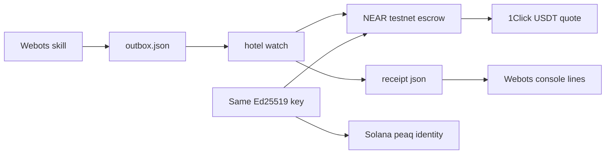

# Run Hotel RaaS end to end

Operator guide: what to install, what to paste, what spends money, and where to look afterward. The product argument is [hotel-raas.md](hotel-raas.md). Short commands stay in the [README](../README.md).

Webots Python **3.9** never signs. It writes `settlement/outbox.json` and prints the receipt. Python **3.10+** under `hotel/` signs NEAR, quotes Intents, and dry-runs peaq.



## One key, two chains

```bash
python -m hotel.cli derive-key --role robot
```

That command writes `keys/robot.json` (gitignored) and prints:

- **NEAR implicit account** — lowercase hex of the 32-byte public key. This is the account that can call the task escrow and receive `wrap.testnet`.
- **Solana address** — base58 of that same public key. This is the peaq machine owner.

Also derive `guest`, `pantry`, and `courier`. Named testnet accounts (`tiago.testnet`, `guest.testnet`, …) are separate: you create them, then add the derived full-access keys. The controller never holds the full-access key. After the escrow exists, `add-function-call-key` limits the robot to `complete` and `pay_supplier`.

## How NEAR works here

NEAR holds the **task escrow**: guest money for one skill.

1. Guest `create_claim` names the robot account, public key, pantry, skill id, price, pantry share (`pantry_bps` 4000 = 40%), and deadline.
2. Guest funds with `wrap.testnet` (`ft_transfer_call`). `fetch_honey` is `5e22` yocto in [config/hotel.json](../config/hotel.json).
3. Webots runs the skill and writes GPS, compass, success, and a telemetry hash to the outbox.
4. `python -m hotel.cli watch --once` (live) or `--offline` reads the outbox. The robot calls `complete` (payout to the robot), then `pay_supplier` (pantry share; robot keeps the spread).
5. The dispatcher **refuses** `courier.testnet` (price above max). That refusal is stored on the receipt. The courier is never paid.

Live broadcast needs `NEAR_ESCROW_ACCOUNT` in `.env` and `escrow_account` in config. Both ship **empty**. Until you paste a real testnet contract account, `create-claim` without `--offline` still writes an offline claim and `watch --once` cannot put a real hash on the HUD.

**Follow a NEAR payment**

- Webots console: `[near] claim …`, `[near] complete <tx-or-offline> <explorer>`, `[near] pay_supplier <tx>`, `[near] courier refused <reason>`.
- File: `settlement/receipts/<claim>.json` (gitignored).
- Explorer: `https://testnet.nearblocks.io/txns/<hash>` once `complete.tx` / `pay_supplier.tx` are real hashes, not `offline`.

## How Solana works here

Solana holds **who the machine is**, not the guest payment. peaq homes the robot on Solana (`home_chain` **5**). Identity, DID, and Machine NFT are Solana accounts. After a skill, an **activity** event can go to the Solana `EventRegistry` at trust level **0**, with NEAR hashes in `rawData` (NEAR is not on the trust-1 chain list). Skill prices in config are under the $10 revenue floor, so this demo does not submit a revenue event.

The peaq **bond** (PEAQ or USDC on Solana) is a subscription lock. It is **not** the NEAR task escrow.

**Follow machine identity and (later) Solana txs**

- Webots console: `[peaq] solana <address> near <implicit> activity <claim>`.
- File: `settlement/peaq_status.json` (gitignored) from `peaq-dry`: address, implicit account, CLI version, `ok` or `cli_missing`, `live: false`.
- After a **funded** activation: Solana explorer on the owner address; peaq MCR for that DID (`home_chain` 5, score 0 until events exist). Dry-run does not create those on-chain records.

## 1. Requirements

- Webots R2023+ with Python **3.9** (`controllers/mission_control/runtime.ini`).
- Python **3.10+** for `hotel/`: `pip install -r requirements.txt`.
- Copy [`.env.example`](../.env.example) to `.env`. Never commit `.env` or `keys/`.
- If `py -3.10` is not the 3.10 binary, set `HOTEL_PYTHON`.
- Optional: Rust + `cargo` to build [`contracts/task_escrow`](../contracts/task_escrow).
- Optional: `pip install 'peaq-os-cli[solana,ows]>=0.0.19'` for identity dry-run.

Leave `INTENTS_LIVE=0` and `PEAQ_LIVE=0` until you mean to spend mainnet.

## 2. Offline loop (no accounts, no spend)

Proves drive + HUD + console lines.

```bash
pip install -r requirements.txt
python -m hotel.cli derive-key --role robot
python -m hotel.cli derive-key --role pantry
python -m hotel.cli derive-key --role guest
python -m hotel.cli derive-key --role courier
python -m hotel.cli create-claim --skill fetch_honey --offline
```

In Webots: **File → Reload World**, then Play. Default `HOTEL_SETTLE=offline` (or set that env). The world already passes `fetch_honey` as `controllerArgs`.

**See:** TIAGo at `(0, 0.25)`, path to the counter, honey grasp, HUD with claim id and `complete` / `pay_supplier` `offline`, and:

```
[near] claim <id> skill fetch_honey
[near] complete offline
[near] pay_supplier offline
[near] courier refused <reason>
[peaq] solana <address> near <implicit> activity <claim>
```

`HOTEL_SETTLE=offline` spawns `watch --once --offline` from the controller. `HOTEL_SETTLE=none` skips settlement.

## 3. NEAR testnet (real hashes)

Create named accounts you control (wallet / near-cli). Paste them into `.env`. Do not invent accounts.

| You fill | Where | Why |
| --- | --- | --- |
| `NEAR_ESCROW_ACCOUNT` | `.env` and `config/hotel.json` `escrow_account` | Account that will hold the wasm |
| `NEAR_GUEST_ACCOUNT` / `NEAR_ROBOT_ACCOUNT` / `NEAR_PANTRY_ACCOUNT` / `NEAR_COURIER_ACCOUNT` | `.env` | Named accounts; guest/robot/pantry need full-access keys from `derive-key` |
| `NEAR_FT_CONTRACT` | `.env` | `wrap.testnet` |
| Guest `wrap.testnet` balance | guest account | At least `price_yocto` for `fetch_honey` |
| `ROBOT_KEYFILE` / `GUEST_KEYFILE` / `PANTRY_KEYFILE` | `.env` | `keys/robot.json` and siblings |

Build and deploy:

```bash
cd contracts/task_escrow
cargo build --target wasm32-unknown-unknown --release
python -m hotel.cli deploy-escrow --wasm target/wasm32-unknown-unknown/release/task_escrow.wasm
python -m hotel.cli init-escrow
python -m hotel.cli add-function-call-key
python -m hotel.cli create-claim --skill fetch_honey
python -m hotel.cli fund-claim --claim <id>
```

Play with `HOTEL_SKILL=fetch_honey` and `HOTEL_SETTLE=live`. In another terminal, on Python 3.10:

```bash
python -m hotel.cli watch --once
```

**See:** same console lines with explorer hashes. The controller does not spawn live `watch`; you run it.

## 4. Register the machine on peaq (Solana)

Dry first. This quotes a bond and writes `settlement/peaq_status.json`. It does not lock SOL/PEAQ.

```bash
python -m hotel.cli peaq-dry
```

`status: cli_missing` means install the CLI extra above. That is a skip, not a failed kitchen run.

A **live** registration spends mainnet: about **0.015 SOL** on the owner, the quoted bond, and about **0.05 PEAQ** on a separate operator wallet. A settled bond is not withdrawn. Only after the testnet kitchen loop is on camera:

1. Set `PEAQ_LIVE=1` in `.env`.
2. Run `python -m hotel.cli peaq-live` and type the confirmation prompt.

After a skill, build the activity payload (still no Solana submit unless you later wire EventRegistry with `PEAQ_LIVE=1`):

```bash
python -m hotel.cli peaq-event --receipt settlement/receipts/<claim>.json
```

Official onboarding: [Onboard a machine on Solana](https://docs.peaq.xyz/peaqos/guides/onboard-on-solana). Events: [peaq events](https://docs.peaq.xyz/peaqos/concepts/events).

## 5. Intents (USDT exit)

There is **no Intents testnet**. After the robot holds NEAR, 1Click can quote a swap from `wrap.near` toward `nep141:usdt.tether-token.near`.

```bash
python -m hotel.cli intents-quote --dry
```

That posts `dry: true`. No spend. Without `INTENTS_JWT` the fee is **0.2%** (hackathon Q-006).

A live fill requires `INTENTS_LIVE=1` **and** typing YES on `python -m hotel.cli intents-quote --live`. Leave `INTENTS_LIVE=0` for screening.

## Still blocked if empty

| Missing | What you get instead |
| --- | --- |
| `NEAR_ESCROW_ACCOUNT` | Offline claims only; no NearBlocks hash |
| Guest wrap.testnet balance | `fund-claim` fails |
| Escrow wasm not deployed / not `init`-ed | Live `create_claim` fails |
| Function-call key not added | Live `complete` / `pay_supplier` cannot use the limited key |
| `peaqos` not on PATH | `peaq_status.json` with `cli_missing`; Solana line still shows the derived address |
| SOL / PEAQ / operator wallet | Dry-run only; no Machine NFT, no MCR events |
| `INTENTS_LIVE=1` + YES | Dry quote only; no USDT move |

Keys, `.env`, `settlement/outbox.json`, `settlement/receipts/*.json`, and `settlement/peaq_status.json` stay gitignored. Do not commit them.
